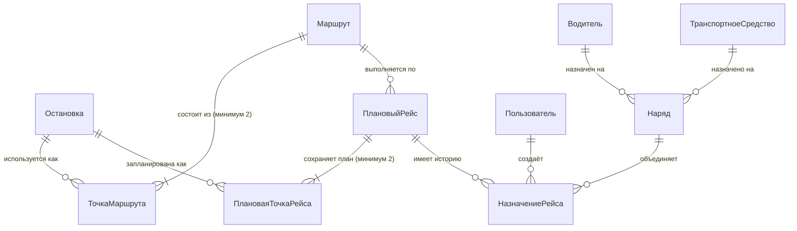
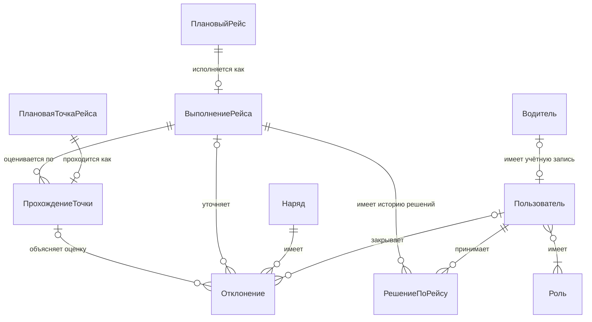
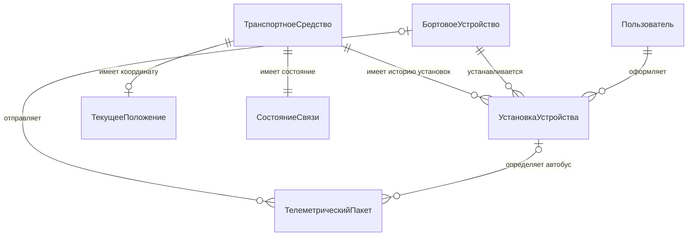
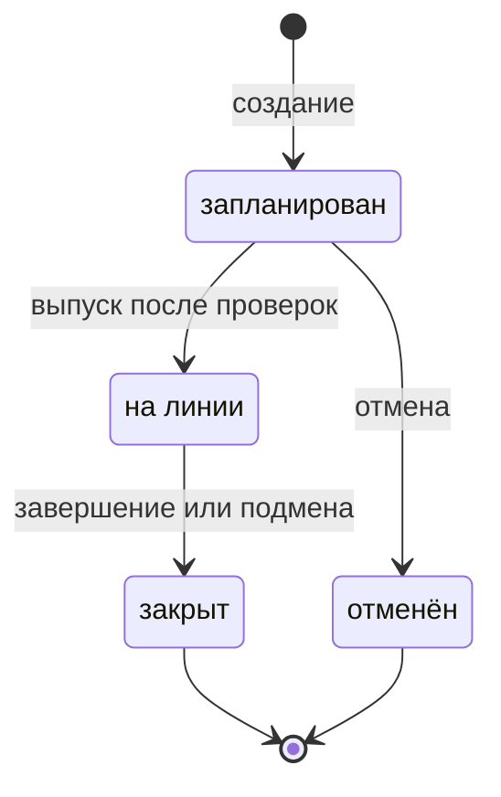
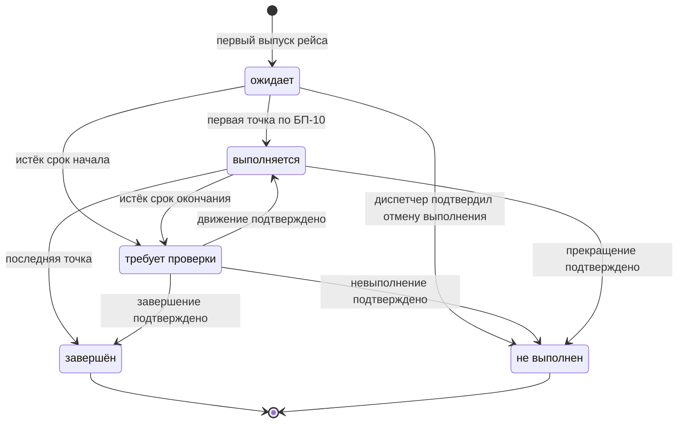
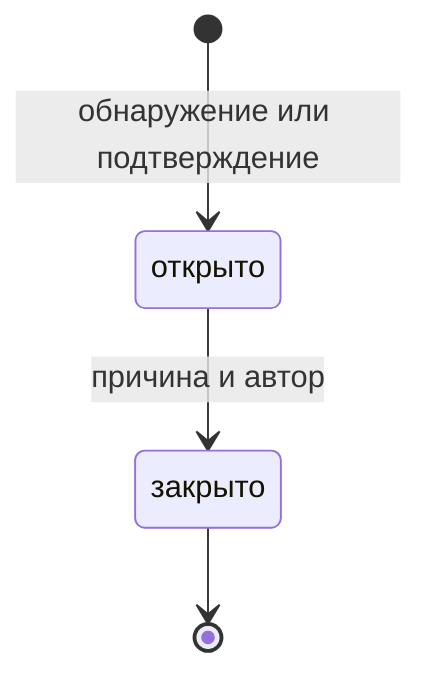
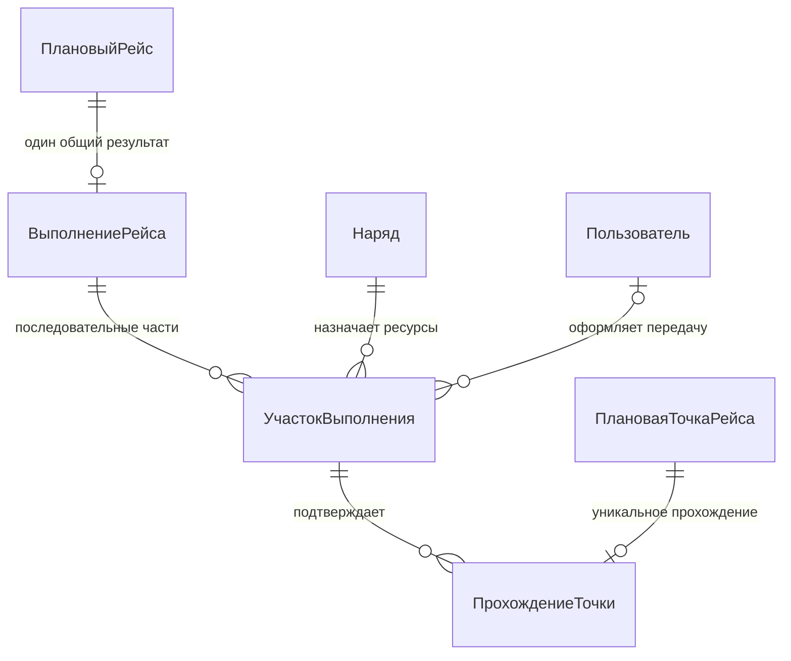

# КТ-01 · Спринт 1

Система мониторинга городского транспорта

Команда: Иванов, Фоминых, Нестеров, Филимонов, Заозёрный, Релин.

СибГУТИ · Курс по базам данных · Осень 2026

# 1. Назначение системы, границы и ожидаемая польза

## 1.1. Предметная область

Городской общественный транспорт одного перевозчика. Перевозчик обслуживает несколько маршрутов по
утверждённому расписанию. Каждое транспортное средство оснащено бортовым устройством, которое
периодически передаёт координату, скорость и время.

Рабочее предположение об имитируемом заказчике: без единой системы мониторинга диспетчер
собирает сведения о сбоях по звонкам водителей и жалобам, а соблюдение расписания оценивается
вручную в конце смены. Это описание учебной ситуации, а не установленный факт о реальном
перевозчике; его нужно проверить при обсуждении требований с имитируемым заказчиком.

## 1.2. Назначение системы

Система принимает телеметрию с бортовых устройств, сопоставляет фактическое движение с плановым
расписанием, автоматически фиксирует отклонения, показывает диспетчеру текущее состояние парка и
даёт пассажиру прогноз прибытия на остановку.

Одной фразой: **система превращает поток координат в оценку исполнения расписания.**

## 1.3. Что входит в границы

- Ведение справочных данных: маршруты, остановки, транспортные средства, водители;
  ввод и хранение расписания, утверждённого вне системы.
- Формирование сменного задания и наряды на смену.
- Контроль допуска водителя и транспортного средства к выпуску на линию.
- Регистрация бортовых устройств и история их установки на автобусы.
- Приём и хранение телеметрии, поддержание текущего положения парка.
- Автоматическая фиксация опоздания, опережения, схода с маршрута и потери связи.
  Невыполнение фиксируется после подтверждения диспетчером; неизвестный результат виден отдельно.
- Обработка отклонений диспетчером, включая подмену транспортного средства или водителя между рейсами.
- Прогноз прибытия на остановку для пассажира.
- Сменный и периодический отчёт о соблюдении расписания.

## 1.4. Что не входит в границы

Каждое исключение — сознательное решение, а не пропуск.

| Исключено | Обоснование |
|---|---|
| Оплата проезда, билеты, валидаторы | Отдельная предметная область с собственными транзакционными требованиями; не участвует ни в одном сценарии контроля исполнения расписания. |
| Кадровый учёт, расчёт заработной платы | Система хранит готовый допуск и назначения водителя; расчёт труда, отдыха и зарплаты остаётся вне учебной модели. |
| Ремонт, склад запасных частей | Техническое состояние представлено единственным атрибутом «дата действия допуска к выпуску», которого достаточно для правила допуска. |
| Построение и оптимизация расписания | Расписание — вход системы, утверждается вне её. Система исполняет и оценивает расписание, а не проектирует его. |
| Учёт топлива, расчёт себестоимости рейса | Требует интеграции с датчиками уровня топлива и справочником норм расхода; не участвует ни в одном из основных сценариев. |
| Мобильные приложения водителя и пассажира | Водитель и бортовое устройство работают как клиенты HTTP API; пассажирский сценарий закрывается веб-страницей. |
| Внешние провайдеры входа (OAuth, SSO) | Роли фиксированы и заводятся администратором; внешняя аутентификация не влияет ни на одно бизнес-правило. |
| Мультиарендность (несколько перевозчиков) | Один перевозчик. Введение арендатора добавляет ключ во все сущности и ни одного нового сценария. |

## 1.5. Ожидаемая польза

Польза формулируется измеримо, чтобы её можно было проверить на приёмке.

| Кому | В чём польза | Как проверяется |
|---|---|---|
| Диспетчер | Получает автоматически выявленные отклонения, не ожидая ручного сообщения. Целевой срок регистрации — не более 2 минут после того, как системе доступны данные, достаточные для проверки соответствующего бизнес-правила. | На демонстрационных данных измеряется время от получения достаточных данных до появления записи. Для потери связи отсчёт начинается после превышения порога отсутствия пакетов, заданного в БП-08. |
| Диспетчер | Видит текущее положение всего парка на одном экране, включая машины, потерявшие связь. | Наличие каждого выпущенного транспортного средства на карте с признаком актуальности данных. |
| Аналитик перевозчика | Получает отчёт о соблюдении расписания за смену автоматически, вместо ручной обработки путевых листов. | Отчёт формируется без ручного ввода данных. |
| Пассажир | Получает ожидаемое время прибытия и видит, основано ли оно на текущем движении или только на расписании. | При достаточных актуальных данных выдаётся прогноз; без них — плановое время с явной пометкой. Если будущих прибытий нет, показывается соответствующее сообщение. |
| Руководство перевозчика | Получает статистику соблюдения расписания по маршрутам за выбранный период через отчёт аналитика. | Отчёт содержит показатели и сведения о неполных или недостоверных данных, позволяющие оценить ограничения результата. |

## 1.6. Ограничения и предположения о среде

- Бортовое оборудование разных поставщиков передаёт пакеты разного состава: обязательны
  идентификаторы устройства и исходного сообщения, координата и время, остальные поля необязательны и различаются.
- Связь на маршруте неустойчива: пропуски и опоздание пакетов — норма, а не сбой.
- Пакеты могут приходить с нарушением порядка и повторяться.
- Расписание поступает в систему как данные и меняется не чаще раза в сутки.

Эти условия — рабочие допущения проекта, которые команда должна подтвердить при уточнении
требований. Для учебной демонстрации поток бортовых данных создаёт симулятор; подключение
реального оборудования не является условием воспроизводимости демонстрации.

Периоды без достоверной телеметрии не позволяют уверенно судить о фактическом движении:
отсутствие данных нужно отличать от подтверждённого нарушения расписания. Числовая цель
регистрации отклонений выше — предложение для приёмки, а не измеренный результат.

# 2. Роли пользователей и основные бизнес-сценарии

## 2.1. Роли

### Администратор справочных данных

- **Кто это:** Сотрудник службы эксплуатации
- **Действия:** Ведёт маршруты, остановки, расписание, парк транспортных средств, учётные записи водителей и допуски. Формирует сменное задание.
- **Ограничения:** Не работает с телеметрией и отклонениями.

### Диспетчер

- **Кто это:** Сотрудник диспетчерской смены
- **Действия:** Выпускает наряды на линию, наблюдает за парком, обрабатывает и закрывает отклонения, выполняет подмену транспортного средства или водителя.
- **Ограничения:** Не изменяет справочные данные и расписание.

### Водитель

- **Кто это:** Работник, выполняющий рейсы
- **Действия:** Просматривает назначенный наряд через веб-страницу; выпуск и закрытие выполняет диспетчер.
- **Ограничения:** Видит только свой наряд.

### Пассажир

- **Кто это:** Внешний анонимный пользователь
- **Действия:** Смотрит остановки маршрута и прогноз прибытия.
- **Ограничения:** Не видит данных о водителях, нарядах и отклонениях.

### Аналитик

- **Кто это:** Сотрудник, отвечающий за качество перевозок
- **Действия:** Строит отчёты о соблюдении расписания за смену и произвольный период.
- **Ограничения:** Только чтение, никаких изменений.

### Бортовое устройство

- **Кто это:** Программно-аппаратный клиент на транспортном средстве (внешняя система)
- **Действия:** Передаёт телеметрические пакеты.
- **Ограничения:** Не выполняет никаких других операций.

## 2.2. Бизнес-сценарии

Семь основных сценариев. Правила и числовые условия определены в `03-business-rules.md`;
ниже описана последовательность действий. Бортовое устройство — внешний участник, а не человек.

### БС-01. Формирование сменного задания

**Актор:** Администратор справочных данных.

**Предусловия:** существуют маршрут, автобусы и водители; администратор имеет право планирования.

**Основной ход:**

1. Администратор выбирает маршрут и дату с утверждённым расписанием.
2. Система создаёт рабочие копии планов рейсов с точками, временами и линией маршрута, сохраняет время создания. Они не обновляются вслед за справочником автоматически.
3. Администратор распределяет рейсы по нарядам, назначает водителя и автобус.
4. Система проверяет единственность назначения и пересечение интервалов по БП-01 и БП-04.
5. Наряды сохраняются как «запланирован».

**Альтернативы:**

- А1. Расписания нет — создание невозможно, показана причина.
- А2. Назначения конфликтуют — сохранение отклоняется с указанием конфликта.
- А3. Рейсы выбранного маршрута на дату уже созданы — открывается существующее задание;
  повторные рейсы не создаются. Другой маршрут на ту же дату создаётся независимо.

- А4. До первого выпуска администратор явно обновляет копию плана по справочнику с основанием.
  Проверки БП-16 и пересечений выполняются заново; при отказе прежний план сохраняется целиком.
- А5. Администратор регистрирует устройство и оформляет установку или снятие по БП-19.
  Конфликт периодов или автобус на линии приводят к отказу; история не перезаписывается.

**Результат:** плановые рейсы существуют без дублей, назначения не противоречат друг другу.

### БС-02. Выпуск транспортного средства на линию

**Актор:** Диспетчер. Получатель назначения: Водитель.

**Предусловия:** наряд запланирован и содержит хотя бы один плановый рейс.

**Основной ход:**

1. Диспетчер запрашивает выпуск наряда.
2. Система проверяет допуски, действующую установку устройства и отсутствие другого наряда на линии у автобуса и водителя.
3. Наряд переводится в «на линии», сохраняется время выпуска. При первом выпуске каждого рейса его план окончательно фиксируется по БП-16.
4. Для плановых рейсов создаются выполнения «ожидает»; водитель может просмотреть свой наряд.

**Альтернативы:**

- А1. Нет действующего допуска или установки устройства — выпуск отклоняется, статус не меняется.
- А2. Автобус или водитель занят — выпуск отклоняется.
- А3. Повторный или одновременный запрос не создаёт повторного выпуска и дубликатов выполнений.

**Результат:** наряд на линии; начало каждого рейса определяется отдельно по БП-10.

### БС-03. Приём телеметрии и обновление текущего положения

**Актор:** Бортовое устройство.

**Предусловия:** сообщение поступило на вход приёма телеметрии.

**Основной ход:**

1. Система сохраняет исходное сообщение и время получения.
2. Проверяет исходный ключ и повтор по БП-18, установку по БП-19, поля и время по БП-07–БП-09.
3. Обновляет подтверждение связи только при выполнении БП-08; повтор и конфликт ключа исключены.
4. Более новая пригодная координата обновляет текущее положение.

**Альтернативы:**

- А1. Старый или повторный пакет сохраняется, но не обновляет положение и связь. Конфликт ключа отмечается отдельно; прежние бизнес-результаты сохраняются.
- А2. Ошибочные поля или время из будущего — сохраняется причина непригодности для расчётов.
- А3. Устройство неизвестно — сообщение помечается, положение парка не меняется.
- А4. Отдельная периодическая проверка обнаруживает отсутствие сообщений более 3 минут
  у автобуса на линии: создаёт одно отклонение потери связи на непрерывный период.
- А5. Сообщения возобновились, но координаты старые — связь восстановлена, положение устарело.

**Результат:** история сохранена; связь и свежесть координат представлены раздельно.

### БС-04. Контроль исполнения рейса

**Инициатор:** поступление пригодной телеметрии или периодическая проверка.
**Получатель результата:** Диспетчер.

**Предусловия:** наряд на линии; существуют плановые рейсы и их выполнения.

**Основной ход:**

1. Система выбирает ожидающий рейс по БП-10 и фиксирует первую точку; выполнение начинается.
2. По следующим координатам фиксирует точки в порядке следования, без повторов.
3. Сравнивает время прохождения с планом по БП-11, создаёт опоздания или опережения.
4. Проверяет выход из коридора по БП-12.
5. Последняя точка завершает выполнение рейса.

**Альтернативы:**

- А1. Достоверных координат нет — прохождения не выдумываются, потеря связи определяется отдельно.
- А2. Начало или окончание не подтверждено в срок БП-13 — выполнение «требует проверки».
- А3. Точка пропущена — система не считает её пройденной; при неподтверждённом завершении
  применяется БП-13. Поздние данные могут служить основанием ручной проверки по БП-13; пропущенные прохождения автоматически не создаются.

**Результат:** известные прохождения оценены; неизвестный результат явно отличается от невыполнения.

### БС-05. Действия диспетчера при отклонениях и завершении работы

**Актор:** Диспетчер.

**Предусловия:** доступна карточка существующего наряда и связанные результаты; действие разрешено для его текущего статуса.

**Основной ход:**

1. Диспетчер выбирает открытое отклонение и изучает данные.
2. Указывает причину и при необходимости комментарий.
3. Система закрывает отклонение, сохраняя автора и время. Причина «недостоверные данные»
   обрабатывается по БП-15; обычное закрытие не стирает факт нарушения.

**Альтернативы:**

- А1. Нужна подмена между рейсами — проверки БП-17, закрытие старого наряда, перенос ожидающих
  рейсов и выпуск нового наряда с сохранением истории и записей выполнений. При отказе все прежние назначения сохраняются.
- А2. Выполнение требует проверки — диспетчер сохраняет основание и результат по БП-13:
  движение продолжается, рейс завершён, не выполнен полностью либо сведений недостаточно.
  Каждая проверка добавляет отдельное решение с автором, временем и основанием; недостаток
  сведений сохраняется без смены статуса. Повторная проверка не перезаписывает прежние записи.
  Возврат в работу разрешён только при наряде на линии; для закрытого доступно подтверждение
  состоявшегося результата. Выполняющийся рейс можно прекратить с подтверждённой причиной.
- А3. Продолжение невозможно — диспетчер подтверждает невыполнение ещё не начатых рейсов
  с причиной; они больше не показываются пассажиру как ожидаемые прибытия.
- А4. Все рейсы завершены или подтверждённо не выполнены — диспетчер закрывает наряд по БП-17.
- А5. Остались только непроверенные выполнения — диспетчер может закрыть наряд с явной
  отметкой и причиной по БП-17. Результаты остаются неизвестными и видны в отчёте.
- А6. Запланированный наряд больше не нужен — отмена по БП-17 освобождает назначения,
  сохраняя плановые рейсы.
- А7. Отклонение не разобрано — оно остаётся открытым и учитывается в отчёте как необработанное.

**Результат:** решения имеют автора и причину; назначения, статусы и история согласованы.

### БС-06. Получение пассажиром времени прибытия

**Актор:** Пассажир.

**Предусловия:** выбрана существующая остановка.

**Основной ход:**

1. Система выбирает ещё не пройденные точки ожидающих и выполняющихся рейсов этой остановки.
2. При достаточных данных вычисляет прогноз по БП-14.
3. Показывает время, маршрут и источник «прогноз» или «по расписанию».

**Альтернативы:**

- А1. Свежих данных нет либо расчётное время уже прошло — используется будущее плановое время.
- А2. Рейс не выполнен или требует проверки — его прибытие не предлагается.
- А3. Подходящих прибытий нет — пустой список с сообщением «Нет доступных прибытий».

**Результат:** пассажир различает оценку по движению и расписание; недостоверное обещание не выдаётся.

### БС-07. Отчёт о соблюдении расписания

**Актор:** Аналитик.

**Предусловия:** аналитик имеет доступ к отчётам.

**Основной ход:**

1. Аналитик выбирает период и при необходимости маршрут.
2. Система отбирает рейсы по плановому началу и считает категории результатов по БП-15.
3. Вычисляет долю достоверных прохождений в графике по завершённым рейсам, показывает исходные числа.
4. Отдельно показывает невыполнение, неизвестные результаты, исключённые данные и открытые отклонения.

**Альтернативы:**

- А1. Завершённых рейсов нет — доля «нет данных»; невыполненные и другие рейсы всё равно посчитаны.
- А2. Прохождение признано недостоверным — исключается из числителя и знаменателя, видно отдельно.
- А3. Период пуст — нулевые количества рейсов и «нет данных» для доли, без ошибки.

**Результат:** отчёт можно пересчитать вручную; неполные данные видны и не маскируются нулём процентов.

## 2.3. Покрытие ролей сценариями

- **Администратор справочных данных:** БС-01 — подготовка назначений.
- **Диспетчер:** БС-02 и БС-05 — выпуск и решения; БС-04 — получение результатов контроля.
- **Водитель:** БС-02 — просмотр своего назначенного наряда.
- **Пассажир:** БС-06 — прибытия.
- **Аналитик:** БС-07 — отчёт.
- **Бортовое устройство:** БС-03 — передача данных.

# 3. Бизнес-правила и критерии приёмки

Пороги времени и расстояния заданы для учебного проекта. Они используются во всех
примерах приёмки. Время в примерах указано в часовом поясе перевозчика.

## 3.1. Бизнес-правила

### Назначения и выпуск

**БП-01. Единственное назначение рейса.** Плановый рейс входит не более чем в один текущий
наряд. При подмене ещё не начатые рейсы переносятся в новый наряд; история прежнего назначения
сохраняется. Начатые и завершённые рейсы не переносятся.

**БП-02. Занятость автобуса.** Один автобус не может одновременно находиться в двух нарядах
со статусом «на линии». При двух одновременных запросах на выпуск проходит не более одного.

**БП-03. Занятость водителя.** Один водитель не может одновременно находиться в двух нарядах
со статусом «на линии». Это ограничение действует и при подмене.

**БП-04. Пересечение плановых назначений.** При сохранении наряда интервалы от начала первого
до окончания последнего рейса не должны пересекаться с интервалами других запланированных
нарядов того же водителя или автобуса. Соприкосновение границ разрешено. Расчёт рабочего времени
и обязательного отдыха находится вне учебной модели; система не подтверждает соблюдение трудовых норм.

**БП-05. Допуск водителя.** Выпуск разрешён только для действующего водителя с отметкой допуска,
действующей на дату выпуска включительно. Отметку и дату вводит администратор по данным
ответственной службы вне системы. Приложение не проводит медицинские проверки и не вычисляет
допуск из даты медицинского осмотра.

**БП-06. Допуск автобуса.** Выпуск разрешён только для действующего автобуса с отметкой допуска,
действующей на дату выпуска включительно. При подмене допуски проверяются повторно.

### Телеметрия

**БП-07. Обновление положения.** Для расчётов принимается первое получение сообщения
с полным ключом по БП-18, известным устройством, определённой установкой, допустимой координатой
и временем формирования в интервале от «время получения минус 3 минуты» до времени получения
включительно. Пакет из будущего в расчётах не участвует. Для обновления текущего состояния
установка должна оставаться действующей при получении. Более новое время формирования
заменяет положение; равное или меньшее — нет. Все получения сохраняются с результатом проверки.

**БП-08. Связь и актуальность — разные признаки.** Связь подтверждает первое получение
сообщения с полным ключом, известным устройством, действующей при формировании и получении
установкой и временем формирования не старше 3 минут и не из будущего. При этом координата
может быть непригодной. Повтор, конфликт ключа и старый пакет связь не восстанавливают: повторная
доставка из буфера не доказывает нового сообщения борта. Для автобуса на линии более 3 минут
без такого подтверждения означает «потеря связи». Если после текущего выпуска подтверждений
не было, отсчёт ведётся от выпуска. Возраст координаты считается отдельно по её времени;
старше 3 минут — устаревшая. Одно непрерывное отсутствие связи создаёт одно отклонение наряда.
Восстановление связи не стирает это отклонение; разбор диспетчером описан в БС-05.

**БП-09. Непригодный пакет.** Проверяются идентификаторы устройства и сообщения, время
формирования, координата. Отсутствующее или нечитаемое поле, широта вне [−90; 90] или долгота
вне [−180; 180] делают пакет непригодным для движения; причина сохраняется. Неизвестное
устройство отмечается отдельно. Без ключа или установки автоматические изменения не выполняются.
При непригодной координате подтверждение связи возможно только по условиям БП-08.
Повторы и конфликты идентификаторов обрабатываются по БП-18.

### Исполнение рейса

**БП-10. Начало и прохождение точек.** После выпуска для каждого рейса наряда существует
выполнение со статусом «ожидает». Кандидат на начало — самый ранний ожидающий рейс наряда;
другого выполняющегося или требующего проверки рейса в нём быть не должно. Первая точка фиксируется по достоверной
телеметрии в радиусе не более 50 метров от её остановки, не раньше чем за 2 минуты до планового
начала и не позже чем через 15 минут после него. Её время становится временем начала выполнения.
Последующие точки фиксируются в порядке маршрута по пакетам с возрастающим временем, каждая
не более одного раза. Один пакет фиксирует не более одной точки. После ручного возврата в работу применяется указатель следующей точки по БП-13. Если следующая точка пропущена,
система не выдумывает её прохождение. Последняя точка завершает выполнение.

**БП-11. Соблюдение времени.** Разница «фактическое время прохождения минус плановое время»
от −2 до +5 минут включительно означает «в графике». Значение меньше −2 минут создаёт
«опережение», больше +5 минут — «опоздание». Для одной точки одного выполнения создаётся
не более одного отклонения соответствующего типа.

**БП-12. Сход с маршрута.** Во время выполнения рейса создаётся одно отклонение «сход с маршрута»,
если достоверные последовательные координаты более 60 секунд показывают удаление более
300 метров от линии маршрута. Промежутки между этими координатами не превышают 30 секунд.
Возврат в коридор или больший промежуток прерывает отсчёт. Отсутствие координат само по себе
не доказывает сход. Геометрия линии маршрута поступает со справочными данными.

**БП-13. Проверка результата рейса.** Если начало не подтверждено спустя 15 минут после
планового начала либо окончание — спустя 15 минут после планового окончания, выполнение
переходит в «требует проверки». Недостаток данных не доказывает невыполнение.

Диспетчер проверяет сведения и сохраняет решение, автора, время решения и основание
(например, сообщение водителя с временем контакта или ссылки на полученные пакеты):

- Рейс продолжается — переход в «выполняется». Нужны подтверждённое время начала не позже времени решения и номер
  следующей ожидаемой плановой точки. Наряд должен оставаться на линии; другого выполняющегося
  рейса в нём быть не должно. Для закрытого наряда возврат в работу запрещён.
- Рейс полностью выполнен — переход в «завершён». Нужны подтверждённые начало и окончание:
  начало не позже окончания, окончание не позже времени решения; времена не противоречат сохранённым достоверным прохождениям. Допускается и после закрытия наряда.
- Рейс не выполнен полностью — переход в «не выполнен» с причиной. Если рейс был начат,
  сохраняются фактическое начало и подтверждённое время прекращения; в отчёте такой случай
  отмечается как прерванный. Если выезда не было, фактические времена остаются пустыми.
- Сведений недостаточно — статус остаётся «требует проверки»; попытка проверки сохраняется.

Подтверждённое прекращение также не может быть раньше начала или позже времени решения. Ручное решение не создаёт прохождения остановок и не подставляет плановое время вместо фактического.
После возврата в работу контроль продолжается со следующей подтверждённой точки, без заполнения
пропусков. Новое прохождение фиксируется только по пригодному пакету. Следующий срок проверки
окончания равен более позднему из двух моментов: плановое окончание плюс 15 минут или время
возврата в работу плюс 15 минут. Он сохраняется, чтобы прежний истёкший срок не возвращал рейс
на проверку сразу после решения. Истечение нового срока снова переводит в «требует проверки».

Каждое принятое ручное решение, включая исход «сведений недостаточно», добавляет отдельную
запись «РешениеПоРейсу» с автором, временем, основанием и статусами до и после. Прежние записи
не изменяются и не удаляются. При продолжении в запись входят подтверждённое начало, следующая
точка и новый срок проверки; при завершении или прекращении — подтверждённые фактические времена.
Сохранение записи и изменение выполнения применяются вместе. Недостаток сведений сохраняется
как результат проверки с основанием, без смены статуса и срока. Некорректный запрос, не прошедший
проверку обязательных данных или разрешений, отклоняется и не создаёт принятого решения.
Повторная проверка после нового истечения срока добавляет следующую запись; число циклов
проверки не ограничено. Автоматические переходы не создают ручных решений.

Поздние пакеты сохраняются и могут служить основанием ручного решения, но сами не меняют
статус проверяемого или оконченного рейса. Диспетчер может также подтвердить прекращение
выполняющегося рейса напрямую. Подтверждённое невыполнение создаёт одно соответствующее отклонение.

**БП-14. Прибытия для пассажира.** Выдаются только ещё не пройденные точки рейсов со статусом
«ожидает» или «выполняется». Для выполняющегося рейса при свежем положении и наличии достоверного
прохождения прогноз равен плановому времени целевой точки плюс отклонение на последней
пройденной точке. Если полученное время уже прошло, прогноз недоступен. При отсутствии прогноза
выдаётся только будущее плановое время с пометкой «по расписанию». Рейсы «не выполнен» и
«требует проверки» не обещаются пассажиру. Если подходящих прибытий нет, выводится
«Нет доступных прибытий» — это не утверждение, что движение фактически закончилось.

### Отчёты и справочные данные

**БП-15. Расчёт отчёта.** Период выбирается по плановому времени начала рейса: начало периода
включается, конец не включается. По завершённым выполнениям берутся достоверные прохождения:
N — их число, K — число прохождений «в графике». Соблюдение расписания = 100 × K / N процентов,
с округлением до одного знака после запятой. При N = 0 показатель — «нет данных», а не 0%.
Отдельно показываются количества плановых, завершённых, невыполненных, требующих проверки
и ещё ожидающих/выполняющихся рейсов, а также рейсов без записи выполнения (ещё не выпущенных). Эти категории не пересекаются и в сумме дают число плановых рейсов. Также показываются N и число всех плановых точек
выбранных рейсов. В числе невыполненных отдельно указывается количество начатых, но прерванных; оно не прибавляется повторно к общему числу рейсов. Для завершённых по решению диспетчера виден источник подтверждения, в K и N входят только реально зафиксированные достоверные прохождения. Доля по известным данным не выдаётся за оценку всего движения.

Закрытие опоздания или опережения с причиной «недостоверные данные» помечает соответствующее
прохождение недостоверным и исключает его и из K, и из N. Остальные причины закрытия не меняют
оценку прохождения. Недостоверные прохождения и отклонения показываются отдельно; история
исправлений с автором и причиной сохраняется. Недостоверное прохождение не используется в прогнозе.

**БП-16. Структура маршрута.** Каждый маршрут описывает одно направление и содержит минимум
две точки. Нумерация точек начинается с 1 без пропусков. Смещение первой точки от начала
рейса равно нулю; следующие смещения строго возрастают. Обратное направление задаётся отдельным
маршрутом. Плановый рейс также содержит минимум две плановые точки.

При формировании задания копируются точки, их координаты, времена и линия маршрута;
сохраняется время создания копии. Изменение справочника само по себе её не меняет.
До первого выпуска администратор вправе выполнить «Обновить план по справочнику» с основанием:
дата, маршрут и время начала рейса остаются прежними, точки, длительность и линия заменяются
вместе. Сохраняются автор и время обновления. Повторно проверяются БП-01, БП-04 и структура
точек; пересчитываются интервалы затронутых нарядов. Операция разрешена только без выполнения
и при отсутствии назначения на наряд на линии; при конфликте остаётся прежняя копия целиком.
При первом выпуске копия становится неизменным снимком: время фиксации, выпуск и создание
выполнения сохраняются вместе. Обновление плана и выпуск одного рейса не могут примениться
одновременно: после ожидания конкурирующая операция повторно проверяет условия.
После фиксации запрещены любые изменения точек, геометрии и времён, включая случаи подмены
и закрытого наряда. Для другой даты или времени начала формируется другой плановый рейс.

**БП-17. Подмена и закрытие.** Подмена разрешена между рейсами, когда в старом наряде нет
выполняющегося или требующего проверки рейса. Старый наряд закрывается, ещё не начатые рейсы
переносятся в новый, новый наряд сразу выпускается, проверки БП-01–БП-06 выполняются для итогового состояния до применения изменений. Выполнения перенесённых рейсов сохраняются в состоянии «ожидает», повторно не создаются. При отказе
сохраняется прежнее состояние целиком. Начатый рейс между автобусами в этой версии не передаётся.
Обычное закрытие наряда разрешено, когда все его выполнения имеют итог «завершён» или
«не выполнен». Если остались только выполнения «требует проверки», диспетчер может явно
закрыть наряд с отметкой «есть непроверенные результаты» и причиной. Статусы этих выполнений
не меняются; после закрытия наряда можно подтвердить завершение или невыполнение, но нельзя вернуть рейс в работу.
Ожидающее или выполняющееся выполнение блокирует закрытие. Время закрытия и диспетчер сохраняются.
Запланированный наряд можно отменить: назначения заканчиваются, плановые рейсы сохраняются
для нового назначения. Выпуск отменённого или закрытого наряда запрещён.

**БП-18. Идентификация и повторная доставка.** Устройство или симулятор до первой отправки
присваивает каждому исходному сообщению постоянный идентификатор UUID. Ключ — пара
«идентификатор устройства, идентификатор сообщения». После перезапуска устройства идентификатор
не используется повторно; при повторной отправке сохраняются идентификатор, время формирования
и всё содержимое. Адаптер поставщика обязан обеспечить этот контракт до первой доставки в систему;
генерация нового ключа при каждом приёме недопустима. Формат без надёжного исходного ключа
сохраняется для разбора, но не участвует в автоматическом контроле.

Каждое получение имеет свой регистрационный номер. При одинаковом ключе и содержимом это
повтор: сохраняются получение и ссылка на первое, но положение, связь, прохождения и отклонения
не меняются. Одинаковый ключ с другим содержимым — конфликт: он отмечается для разбора,
первое сообщение и его результат не переписываются. Сравниваются все поля исходного документа,
включая дополнительные поля поставщика, после нормализации порядка ключей и записи чисел;
поля доставки (время приёма, номер получения) исключаются. Используется SHA-256 нормализованного
содержимого. Одинаковые время и координата при разных ключах сами по себе не означают повтор.

Реестр ключей и отпечатков сохраняется 35 суток после первого получения; повтор срок не продлевает.
Это превышает 30 суток хранения сырой телеметрии. После удаления ключа исходное сообщение
с неизменным старым временем всё равно не проходит трёхминутное окно БП-07 и БП-08. Обнаружение
повторного использования ключа с изменённым содержимым гарантируется только в пределах 35 суток;
сам контракт устройства запрещает такое использование всегда. Непригодное первое получение
не становится пригодным при повторе. Одновременные доставки одного ключа дают не более одного
набора бизнес-изменений; регистрация обработки и её результаты сохраняются вместе.

**БП-19. Установка бортового устройства.** У автобуса и устройства в любой момент не более
одной действующей установки. Интервалы [начало; окончание) не пересекаются. Администратор
оформляет установку и снятие с автором, временем и основанием; задним числом они не меняются.
Перестановка разрешена только вне линии обоих затронутых автобусов. Закрытие прежней установки
и открытие новой в один момент применяются вместе, иначе всё остаётся прежним. При выпуске
на автобусе должно быть одно действующее зарегистрированное устройство.

Получение относится к установке, действовавшей на время формирования сообщения. При
непригодном времени или отсутствии установки принадлежность не угадывается. Позднее сообщение
со старой установки сохраняется у прежнего автобуса, но после снятия не обновляет его текущее
состояние и не влияет на новый автобус. Исторические ссылки не переписываются после перестановки.

## 3.2. Критерии приёмки

Все примеры используют зарегистрированные устройства с действующими установками, исходные ключи сообщений, действующие справочники и допуски,
если в условии не указано обратное. В проверках одного ограничения остальные условия выпуска
и назначения выполнены. 

### БС-01. Формирование сменного задания

- **КП-01.1.** Дано расписание маршрута А на дату с 10 рейсами. Когда задание создают дважды,
  тогда существуют ровно 10 плановых рейсов. Создание задания для маршрута Б на ту же дату разрешено.
- **КП-01.2.** Дано назначение автобуса с 10:00 до 12:00. Когда сохраняют другой наряд этого
  автобуса с 11:00 до 13:00, тогда получают отказ по БП-04; с 12:00 до 13:00 — сохранение разрешено.
- **КП-01.3.** Дано включение рейса в наряд №1. Когда его добавляют в №2 без процедуры подмены,
  тогда получают отказ по БП-01.
- **КП-01.4.** Дано две точки со смещениями 0 и 0 минут. Когда сохраняют маршрут, тогда получают
  отказ по БП-16; смещения 0 и 10 минут допустимы.

- **КП-01.5.** План создан с точками А 10:00, Б 10:10. Справочник изменён на Б +12 минут.
  Без команды план остаётся 10:10. До выпуска явное обновление с основанием меняет Б на 10:12,
  сохраняет автора и время, пересчитывает интервал наряда. После первого выпуска обновление
  отклоняется; зафиксированные 10:12 и время фиксации не меняются.
- **КП-01.6.** У наряда окончание 10:30, следующий наряд того же автобуса начинается в 10:30.
  Обновление плана увеличивает окончание до 10:35. Сохранение отклоняется по БП-04; все прежние
  точки и времена остаются. При одновременном выпуске и обновлении применяется согласованный
  порядок: после выпуска обновление запрещено, после обновления выпуск фиксирует обновлённый план.
- **КП-01.7.** Попытка сохранить маршрут с одной точкой либо рейс с одной плановой точкой
  отклоняется. Две точки с номерами 1 и 2, смещениями 0 и 10 минут проходят проверку структуры.
- **КП-01.8.** Устройство У-1 установлено на А до 11:00. Оба автобуса вне линии. В 11:00
  администратор переносит его на Б. Старая установка заканчивается в 11:00, новая начинается
  в 11:00. Вторая пересекающаяся установка устройства или автобуса запрещена; при автобусе
  на линии вся перестановка отклоняется. Авторы и основания обеих операций сохранены.

### БС-02. Выпуск на линию

- **КП-02.1.** Дано наряд «запланирован» и допуски до даты выпуска включительно. Когда диспетчер
  выпускает наряд, тогда он «на линии», время выпуска сохранено, выполнения рейсов «ожидают».
- **КП-02.2.** Дано допуск водителя, истёкший вчера. Когда выполняют выпуск, тогда получают
  отказ по БП-05, наряд остаётся запланированным. Аналогичная проверка выполняется для автобуса.
- **КП-02.3.** Дано два одновременных запроса выпуска одного наряда. Когда оба обработаны,
  тогда выпуск зафиксирован один раз, повторный запрос не создаёт второй выпуск. Если автобус
  или водитель уже на линии в другом наряде, выпуск нового отклоняется по БП-02 или БП-03.

### БС-03. Приём телеметрии

- **КП-03.1.** Дано положение на 10:00:30. Когда в 10:01 приходит пакет на 10:00:10,
  тогда он остаётся в истории, положение не изменяется. Пакет на 10:00:40 обновляет положение.
- **КП-03.2.** Когда в 10:01 приходит пакет на 10:02 либо пакет без координаты, тогда положение
  не меняется, сохраняется причина непригодности. Повтор пригодного пакета не дублирует прохождение.
- **КП-03.3.** Дано выпуск в 10:00 без последующих сообщений. Когда проверка выполняется
  в 10:03:01 и повторно в 10:03:10, тогда существует одно отклонение потери связи.
- **КП-03.4.** Дано положение на 10:00. В 10:04 впервые приходит сообщение с новым ключом, временем
  10:03:50 и непригодной координатой от действующей установки. Тогда связь восстановлена,
  положение остаётся устаревшим и прогноз по нему не выдаётся.

- **КП-03.5.** Одна пригодная посылка с ключом (У-1, М-1) доставлена трижды, два получения
  одновременно. Тогда сохранены три получения, два отмечены повтором; прохождение и связанное
  опоздание созданы по одному. Поздний повтор после потери связи её не восстанавливает.
- **КП-03.6.** После первого сообщения М-1 приходит тот же ключ с другой координатой.
  Получение отмечается конфликтом, прежние данные не меняются. М-2 с теми же координатой
  и временем — отдельное сообщение, но равное время не обновляет положение и не дублирует точку.
- **КП-03.7.** После перестановки У-1 с А на Б в 11:00 пришло сообщение на 10:59:50.
  Оно относится к старой установке А, не обновляет А после снятия и не влияет на Б.
  Сообщение на 11:00 относится к Б. Без читаемого времени установка не определяется.
- **КП-03.8.** Устройство перезапущено: следующее сообщение получает новый UUID. Повтор старого
  сохраняет прежний ключ и не даёт бизнес-эффектов. Получение без message_id сохраняется
  непригодным, генерация идентификатора на сервере не делает его пригодным.
- **КП-03.9.** После 35 суток ключ удалён. Повтор исходного сообщения с прежним временем
  не проходит окно трёх минут и не изменяет положение, связь, прохождения и итог рейса.

### БС-04. Контроль исполнения

- **КП-04.1.** Дано ожидающий рейс с началом 10:00. Когда пригодная координата первой точки
  получена на 10:00 в 40 метрах от остановки, тогда выполнение начинается и первая точка
  фиксируется один раз. Повторный пакет эту запись не дублирует.
- **КП-04.2.** Дано плановое прохождение промежуточной точки в 10:00. Тогда прохождение
  в 09:58 и 10:05 — в графике, в 09:57 — опережение на 3 минуты, в 10:06 — опоздание на 6 минут.
- **КП-04.3.** Дано координаты в 400 метрах от линии в моменты 10:00:00, 10:00:20, 10:00:40,
  10:01:00 и 10:01:10. Тогда создаётся одно отклонение схода. Если есть только первая и последняя
  координаты, непрерывность не подтверждена и отклонение не создаётся.
- **КП-04.4.** Дано начало по плану в 10:00 без зафиксированной первой точки. Когда наступает
  10:15:01, тогда статус «требует проверки», а не «не выполнен»; автоматического обвинения в срыве нет.
- **КП-04.5.** Когда последняя точка зафиксирована после всех предыдущих, тогда выполнение
  завершено. Если последняя точка не подтверждена спустя 15 минут после планового окончания,
  тогда выполнение требует проверки.

### БС-05. Действия диспетчера

- **КП-05.1.** Когда диспетчер закрывает отклонение с причиной, тогда сохраняются причина,
  автор и время; без причины закрытие отклоняется.
- **КП-05.2.** Дано наряд между рейсами и 4 ещё не начатых рейса. Когда выполняют допустимую
  подмену, тогда старый наряд закрыт, 4 рейса перенесены в новый, история прежнего назначения
  доступна. При просроченном допуске нового автобуса все назначения остаются прежними.
- **КП-05.3.** Дано рейс «требует проверки». Когда диспетчер подтверждает невыполнение с причиной,
  тогда статус «не выполнен», существует одно соответствующее отклонение. Без подтверждения
  статус остаётся «требует проверки».
- **КП-05.4.** Дано все рейсы наряда завершены или подтверждённо не выполнены. Когда диспетчер
  закрывает наряд, тогда автобус и водитель освобождаются. При выполняющемся рейсе закрытие запрещено.
- **КП-05.5.** Дано наряд только с выполнением «требует проверки». Когда диспетчер явно
  закрывает его с причиной и отметкой непроверенного результата, тогда ресурсы освобождены,
  выполнение остаётся «требует проверки» и видно в отчёте.
- **КП-05.6.** Дано запланированный наряд. Когда его отменяют, тогда назначения завершены,
  плановые рейсы сохранены для повторного назначения; выпуск отменённого наряда отклоняется.

- **КП-05.7.** Дано рейс «требует проверки» без прохождений. Диспетчер подтверждает полное
  выполнение с началом 10:00, окончанием 10:30 и основанием в 10:40. Тогда статус «завершён»,
  источник решения сохранён, прохождений по-прежнему нет.
- **КП-05.8.** Дано наряд на линии, другой рейс не выполняется. Диспетчер подтверждает,
  что проверяемый рейс начат в 10:00 и продолжается, следующая точка — третья. Тогда статус
  «выполняется», контроль ожидает третью точку; первая и вторая не создаются задним числом.
- **КП-05.9.** Дано наряд закрыт. Попытка вернуть рейс в «выполняется» отклоняется без изменения
  данных. Подтверждение уже состоявшегося завершения с основанием разрешено.
- **КП-05.10.** Дано плановое окончание 10:30, возврат в работу в 10:50. Следующая проверка
  окончания назначена на 11:05. В 10:51 рейс не возвращается на проверку из-за старого срока;
  в 11:05:01 при неподтверждённом окончании снова «требует проверки».
- **КП-05.11.** Подтверждение завершения без основания, с окончанием раньше начала либо
  с окончанием в будущем отклоняется. При недостатке сведений диспетчер сохраняет попытку
  проверки без изменения статуса.
- **КП-05.12.** Дано выполняющийся рейс, начало 10:00, поломка в 10:12. В 10:15 диспетчер
  подтверждает прекращение с причиной. Тогда «не выполнен», начало 10:00 и прекращение 10:12
  сохранены; рейс учитывается как прерванный, известные прохождения не удаляются.

- **КП-05.13.** Дано выполнение требует проверки, история решений пуста. Диспетчер в 10:46
  фиксирует отсутствие ответа водителя, в 10:48 — недостаточность полученных координат.
  Тогда созданы две разные записи с исходом «сведений недостаточно», их авторами, временем
  и основаниями; в обеих статусы до и после — «требует проверки». Срок и статус выполнения
  не изменились, первая запись сохранена без изменений.
- **КП-05.14.** Дано плановое окончание 10:30, выполнение требует проверки, наряд на линии,
  конкурирующего выполнения нет. В 10:50 диспетчер подтверждает продолжение с началом 10:00,
  следующей точкой 3 и основанием: создано решение № 1 со сроком 11:05. Без подтверждения
  окончания в 11:05:01 выполнение снова требует проверки; число ручных решений осталось 1.
  В 11:06 диспетчер повторно подтверждает продолжение, следующая точка 3: создано решение № 2
  со сроком 11:21. В 11:21:01 без подтверждения вновь требуется проверка. В 11:22 другой
  диспетчер сохраняет недостаток сведений: появляется решение № 3 с его авторством, статус
  не меняется. Все три записи доступны; сроки 11:05 и 11:21 в первых двух не перезаписаны.

### БС-06. Прибытия

- **КП-06.1.** Дано в 10:00 свежая координата, последнее достоверное прохождение с опозданием
  2 минуты, следующая остановка по плану в 10:10. Тогда пассажир получает 10:12 с пометкой «прогноз».
- **КП-06.2.** При тех же условиях, но возрасте координаты 4 минуты, тогда выдаётся 10:10
  с пометкой «по расписанию».
- **КП-06.3.** Когда все подходящие рейсы не выполнены, требуют проверки либо уже прошли остановку
  и будущих плановых прибытий нет, тогда список пуст и показано «Нет доступных прибытий».

### БС-07. Отчёт

- **КП-07.1.** Дано 100 достоверных прохождений завершённых рейсов, из них 92 в графике.
  Тогда N = 100, K = 92, показатель 92,0%.
- **КП-07.2.** Дано 10 плановых рейсов, все подтверждённо не выполнены, прохождений нет.
  Тогда отчёт показывает 10 невыполненных рейсов, N = 0 и «нет данных» для доли прохождений в графике.
- **КП-07.3.** Дано из 100 прохождений 92 в графике; одно из остальных признано недостоверным.
  Тогда N = 99, K = 92, показатель 92,9%, отдельно показано одно исключённое прохождение.
- **КП-07.4.** Дано один рейс требует проверки и один выполняется. Тогда оба показаны в своих
  категориях, их прохождения не входят в K и N завершённых рейсов.

- **КП-07.5.** Дано один рейс завершён вручную без прохождений и один прерван после начала.
  Тогда плановых рейсов 2, завершённых 1, невыполненных 1 (из них прерванных 1), N = 0,
  доля «нет данных». Подтверждение завершения не даёт автоматически 100%.

- **КП-07.6.** У завершённого рейса два достоверных прохождения: одно в графике, одно опоздало.
  До исправления K = 1, N = 2, доля 50,0%. Диспетчер признаёт опоздавшее прохождение
  недостоверным: после пересчёта K = 1, N = 1, доля 100,0%; отдельно видна одна недостоверная
  точка. После очистки кэша результат тот же. Доля не означает прохождение всех плановых точек.

## 3.3. Проверки бизнес-правил

- БП-01–БП-04: КП-01.2, КП-01.3, КП-02.3, КП-05.2.
- БП-05–БП-06: КП-02.1, КП-02.2, КП-05.2.
- БП-07–БП-09: КП-03.1–КП-03.9.
- БП-10–БП-13: КП-04.1–КП-04.5, КП-05.3, КП-05.7–КП-05.14.
- БП-14: КП-06.1–КП-06.3.
- БП-15: КП-07.1–КП-07.6.
- БП-16: КП-01.4–КП-01.7.
- БП-17: КП-05.2, КП-05.4–КП-05.6.

- БП-18: КП-03.5, КП-03.6, КП-03.8, КП-03.9.
- БП-19: КП-01.8, КП-03.7.

# 4. Словарь терминов

| Термин | Определение | Не путать с |
|---|---|---|
| **Остановка** | Географическая точка, где предусмотрена посадка и высадка пассажиров. Существует независимо от маршрутов и может использоваться несколькими маршрутами. | Точка маршрута |
| **Маршрут** | Утверждённый упорядоченный путь следования в одном направлении, обозначенный номером и направлением. Определяет состав и порядок остановок, но не время движения. | Рейс |
| **Точка маршрута** | Остановка в составе конкретного маршрута: порядковый номер и плановое смещение времени от начала рейса. Используется как контрольная точка при оценке исполнения. | Остановка |
| **Плановая точка рейса** | Посещение остановки в конкретном плановом рейсе: сохранённые порядок, координаты и плановое время. После выпуска не меняется вместе со справочником. | Точка маршрута |
| **Назначение рейса** | Запись о включении планового рейса в наряд с периодом действия, автором и причиной. Сохраняет историю подмен; текущее назначение не более одного. | Наряд |
| **Состояние связи** | Сведения о поступлении сообщений устройства, существующие даже до первой пригодной координаты. | Текущее положение |
| **Расписание** | Набор плановых рейсов маршрута на календарную дату. Поступает в систему извне как данные. | Наряд |
| **Плановый рейс** | Один предусмотренный расписанием проход маршрута с конкретным временем начала. Существует до того, как назначено транспортное средство. | Выполнение рейса |
| **Выполнение рейса** | Запись о состоянии и результате исполнения планового рейса. Создаётся при выпуске наряда в состоянии «ожидает»; хранит фактические времена, когда они известны, и итог либо необходимость проверки. | Плановый рейс |
| **Прохождение контрольной точки** | Зафиксированный по телеметрии факт прибытия транспортного средства в плановую точку рейса с указанием времени и отклонения от плана. | Телеметрический пакет |
| **Наряд** | Назначение пары «водитель — транспортное средство» на набор плановых рейсов в пределах одной смены. Переходит в работу при выпуске на линию; закрывается после обработки всех рейсов или при подмене между рейсами по БП-17. В одной смене может быть несколько последовательных нарядов. | Смена, Плановый рейс |
| **Смена** | Период работы водителя; нормативный расчёт труда и отдыха находится вне учебной модели. Наряд действует внутри одной смены. | Наряд |
| **Выпуск на линию** | Действие диспетчера, переводящее наряд в работу после проверки допуска водителя и транспортного средства. | Начало рейса |
| **Допуск к выпуску** | Отметка ответственной службы о разрешении выпуска водителя или автобуса с датой действия включительно. Вводится администратором; основания выдачи проверяются вне системы. | Наряд |
| **Бортовое устройство** | Зарегистрированный источник сообщений с постоянным идентификатором. | Автобус |
| **Установка устройства** | Период закрепления устройства за автобусом с автором и основанием. | Текущее положение |
| **Идентификатор исходного сообщения** | Постоянный UUID, присвоенный источником до первой отправки; при повторной доставке сохраняется. | Номер получения на сервере |
| **Телеметрический пакет** | Одно получение сообщения устройства с исходным ключом, координатой, временем и дополнительными полями. Повтор исходной посылки даёт другое получение, но тот же исходный ключ. | Текущее положение |
| **Текущее положение** | Последняя пригодная координата транспортного средства, её время формирования, скорость при наличии и признак актуальности. Не более одного положения на транспортное средство; время получения сообщения для контроля связи учитывается отдельно (БП-08). | Телеметрический пакет |
| **Потеря связи** | Отсутствие сообщений известного устройства автобуса на линии дольше порога БП-08. До первого сообщения отсчёт идёт от выпуска. Не означает неисправность или подтверждённое невыполнение. | Невыполнение рейса |
| **Коридор маршрута** | Полоса допустимого удаления от линии маршрута. Для фиксации схода дополнительно нужны длительность выхода и последовательность достоверных координат по БП-12. | Маршрут |
| **Отклонение** | Зафиксированное системой расхождение фактического исполнения рейса с планом, отнесённое к одному из типов: опоздание, опережение, сход с маршрута, потеря связи, невыполнение рейса. Требует реакции диспетчера и закрывается с указанием причины. | Прохождение контрольной точки |
| **Прогноз прибытия** | Плановое время целевой точки с поправкой на отклонение последнего достоверного прохождения, при свежей координате (БП-14). Величина оценочная. | Плановое время |
| **Соблюдение расписания** | Доля достоверных прохождений в графике среди достоверных прохождений завершённых рейсов за период. Полнота данных и невыполненные рейсы показываются отдельно (БП-15). | Отклонение |
| **Решение по рейсу** | Одна сохранённая проверка диспетчера: исход, автор, время и основание. Недостаток сведений также сохраняется отдельной записью без смены статуса. | Текущий статус выполнения |
| **Требует проверки** | Статус выполнения, начало или окончание которого не подтверждено в установленный срок (БП-13). Не означает доказанного невыполнения. | Не выполнен |
| **Не выполнен** | Итог: полный запланированный проход не выполнен. Диспетчер сохраняет причину; если движение началось и прекратилось, рейс дополнительно отмечается как прерванный. | Требует проверки |

## Термины, от которых решено отказаться

- **Инцидент.** Изначально предполагался отдельно от отклонения. Отказались: содержательной разницы
  между «инцидентом» и «отклонением, требующим реакции» не нашлось, а две сущности вместо одной
  усложняют модель и добавляют термин, который пришлось бы защищать (ЖР-05).
- **Путевой лист.** Его оформление находится вне проекта. Наряд в нашей модели — назначение
  водителя и автобуса на рейсы, а не замена путевого листа.
- **Рейс** без уточнения. Слово двусмысленно: означает и план, и факт. Всегда пишем либо
  «плановый рейс», либо «выполнение рейса».

# 5. Концептуальная модель предметной области

## 5.1. ER-модель

### 5.1.1. Планирование и назначения

### 5.1.2. Выполнение, решения и отклонения

### 5.1.3. Устройства и телеметрия

Количество объектов в связи: 1 — ровно один, 0..1 — не более одного, 1..N — один или несколько,
0..N — любое количество; 2..N — не менее двух. В исходной Mermaid-схеме минимум две точки
дополнительно указан в подписи связи; в PDF и SVG он показан числом 2..N на конце связи.

## 5.2. Сущности

### Справочные данные

**Остановка** (Stop) — географическая точка посадки и высадки.
Атрибуты: _наименование_, _координата_ (широта, долгота), признак действующей.
Идентификатор: наименование в сочетании с координатой.

**Маршрут** (Route) — утверждённый путь следования.
Атрибуты: _номер маршрута_, _направление_, наименование, линия маршрута (геометрия), вид транспорта, признак действующего.
Идентификатор: номер маршрута и направление.

**ТочкаМаршрута** (RoutePoint) — остановка в составе маршрута.
Атрибуты: _порядковый номер в маршруте_, плановое смещение времени от начала рейса.
Идентификатор: маршрут в сочетании с порядковым номером. Слабая сущность: без маршрута не существует.

**ТранспортноеСредство** (Vehicle) — единица парка.
Атрибуты: _государственный регистрационный номер_, вид транспорта, вместимость, дата действия отметки о техническом состоянии, признак действующего.
Идентификатор: государственный регистрационный номер.

**БортовоеУстройство** — зарегистрированный источник телеметрии.
Атрибуты: постоянный идентификатор устройства, поставщик, формат сообщения, признак действующего.
Идентификатор не переиспользуется после списания. Устройство может временно не быть установлено.
Симулятор соблюдает тот же контракт идентификации сообщений, что и бортовое устройство (БП-18).

**УстановкаУстройства** — период закрепления одного устройства за одним автобусом.
Атрибуты: номер установки, начало, окончание (может отсутствовать), автор и основание установки,
автор и основание снятия. Каждая установка связана с одним устройством, одним автобусом и
пользователем, оформившим её. Идентификатор: номер установки. Период включает начало и не
включает окончание. У устройства и автобуса периоды установок не пересекаются (БП-19).
Закрытая установка сохраняется. Принадлежность принятого сообщения определяется по времени
его формирования и сохраняется; перемещение устройства её не переписывает. История нужна
для поздних сообщений и разбора событий прошлой смены, а не только для текущей карты.

**Водитель** (Driver) — работник, выполняющий рейсы.
Атрибуты: фамилия, имя, отчество, _номер водительского удостоверения_, дата действия допуска к выпуску, признак действующего.
Идентификатор: номер водительского удостоверения.

**Пользователь** (User) — учётная запись работника перевозчика.
Атрибуты: _логин_, фамилия и имя, признак активной.
Идентификатор: логин.

**Роль** (Role) — набор полномочий.
Атрибуты: _наименование роли_ (перечисление: администратор справочных данных, диспетчер, водитель,
аналитик).
Идентификатор: наименование роли. У пользователя одна или несколько ролей; роль может быть ещё никому не назначена.

### Планирование и выполнение

**ПлановыйРейс** (PlannedTrip) — предусмотренный расписанием проход маршрута.
Атрибуты: _дата_, _плановое время начала_, плановая длительность, сохранённая линия маршрута для контроля схода, время создания копии плана, время и автор последнего явного обновления, основание обновления, время окончательной фиксации (до первого выпуска отсутствует).
Порядок остановок и времена представлены сущностью «ПлановаяТочкаРейса».
Идентификатор: маршрут в сочетании с датой, плановым временем начала (направление определено маршрутом).

**ПлановаяТочкаРейса** — запланированное посещение остановки в конкретном рейсе.
Атрибуты: порядковый номер, плановое время прибытия, сохранённые наименование и координата остановки.
Идентификатор: плановый рейс и порядковый номер. Создаётся по точке маршрута при формировании плана.
При формировании задания создаётся рабочая копия плана. Справочник не обновляет её автоматически.
До первого выпуска администратор может явно обновить точки, времена и линию по БП-16; дата,
маршрут и плановое начало рейса остаются прежними. При первом выпуске копия окончательно
фиксируется вместе с созданием выполнения. После этого набор точек, их порядок, координаты,
времена и линия не изменяются, в том числе при подмене. Справочник меняется независимо.
Связь с остановкой указывает происхождение; для оценки используются сохранённые координаты.

**Наряд** (Duty) — назначение пары «водитель — транспортное средство» на набор плановых рейсов
одной смены.
Атрибуты: _номер наряда_, дата смены, статус (перечисление: запланирован, на линии, закрыт, отменён), время
выпуска, время закрытия, автор и причина закрытия, отметка непроверенных результатов, суммарная плановая длительность.
Идентификатор: номер наряда, присваиваемый при планировании. Состав наряда определяется записями назначения рейсов; исторические назначения не удаляются.

**НазначениеРейса** — факт включения одного планового рейса в один наряд.
Атрибуты: номер записи назначения, начало действия, окончание действия (может отсутствовать),
причина назначения, автор создания; при прекращении — автор и причина прекращения.
Идентификатор: номер записи назначения. У одного рейса не более одной записи без окончания действия.
При подмене прежняя запись заканчивается, новая начинается в тот же момент; у них разные наряды.
Завершённые рейсы сохраняют последнее назначение на закрытый наряд. Наличие текущей записи
назначения само по себе не означает, что наряд на линии или водитель занят.

**ВыполнениеРейса** (TripExecution) — состояние и результат исполнения планового рейса.
Атрибуты: статус (перечисление: ожидает, выполняется, завершён, требует проверки, не выполнен), фактическое время
начала, фактическое время окончания. Доля точек в графике вычисляется по БП-15 и не является самостоятельным фактом выполнения.
Идентификатор: плановый рейс. Связь с плановым рейсом «один к нулю или одному»: выполнение создаётся при первом выпуске рейса в статусе «ожидает»; при переносе ожидающего рейса эта же запись сохраняется; неизвестный результат отличается от подтверждённого невыполнения. Текущие подтверждённые времена, источник завершения, время прекращения при прерывании, следующая ожидаемая точка и следующий срок проверки хранятся в выполнении. Каждое ручное решение и попытка проверки представлены отдельной сущностью «РешениеПоРейсу». Текущий статус меняется как по ручным решениям, так и по телеметрии и истечению срока; он не определяется только последним ручным решением. Ручное завершение не создаёт прохождения.

**РешениеПоРейсу** — сохранённый результат одной проверки или подтверждения диспетчером.
Атрибуты: порядковый номер в истории выполнения, время регистрации решения, исход
(продолжить движение, подтвердить завершение, подтвердить невыполнение, сведений недостаточно),
основание, статус до и после решения. В зависимости от исхода сохраняются подтверждённые
начало и окончание либо время прекращения, следующая ожидаемая плановая точка и назначенный срок проверки.
Идентификатор: выполнение рейса и порядковый номер решения. Каждая запись относится ровно
к одному выполнению и имеет ровно одного автора-пользователя. У выполнения может быть любое
число решений, в том числе ни одного. Записи не изменяются и не удаляются; последующая
допустимая проверка добавляет запись, сохраняя прежние основания, времена и сроки.
При исходе «сведений недостаточно» статусы до и после одинаковы, новый срок не назначается;
основание описывает, какие сведения проверены и чего не хватило. Следующая точка, если указана,
принадлежит тому же плановому рейсу. Состав обязательных данных и допустимость решения определяет БП-13.
Сохранение принятого решения и его изменений выполнения производится вместе. Отклонённый
некорректный запрос не становится принятым решением. Автоматическое истечение срока меняет
выполнение, но не создаёт ручного решения с вымышленным автором.

**ПрохождениеТочки** (CheckpointPassage) — зафиксированный факт прибытия в контрольную точку.
Атрибуты: фактическое время прибытия, отклонение от планового времени (в минутах), признак «в
графике», признак достоверности, причина и автор исправления.
Идентификатор: плановая точка рейса. Прохождение связано с выполнением того же планового рейса;
его время сравнивается с сохранённым временем плановой точки, а не с текущим справочником.

**Отклонение** (Deviation) — расхождение фактического исполнения с планом.
Атрибуты: номер отклонения, тип (перечисление: опоздание, опережение, сход с маршрута, потеря связи, невыполнение
рейса), время обнаружения, числовое значение отклонения, статус (открыто, закрыто), причина закрытия
(перечисление, включая «выполнена подмена» и «недостоверные данные»), комментарий, время закрытия.
Идентификатор: номер отклонения. Время и тип сами по себе не гарантируют уникальности.
Для опоздания и опережения обязательна связь с конкретным прохождением и его выполнением; прохождение и выполнение должны относиться к одному плановому рейсу.
Для невыполнения и схода обязательно выполнение, а прохождение не требуется. Потеря связи
может относиться только к наряду, в том числе между рейсами. Наряд — тот, к которому событие
относилось при обнаружении; последующие подмены эту связь не переписывают.

### Данные о движении

**ТелеметрическийПакет** (TelemetryPacket) — единичное сообщение бортового устройства.
Атрибуты: регистрационный номер получения, время получения, идентификатор бортового устройства, идентификатор исходного сообщения, время формирования, координата, скорость, состав
дополнительных полей зависит от поставщика оборудования и заранее не фиксирован, состояние разбора
(разобран, не разобран, неизвестное устройство), пригодность для расчётов и причина отказа.
При указанной установке её устройство совпадает с источником пакета.
Идентификатор записи получения: регистрационный номер при приёме. Одна исходная посылка
может иметь несколько получений. Её ключ — идентификатор устройства и постоянный идентификатор
сообщения, присвоенный до первой отправки. Сохраняются результат дедупликации (первое получение,
повтор, конфликт идентификатора, ключ не определён), ссылка на первое получение при наличии,
отпечаток содержимого, время первого получения и определённая установка. Правила сравнения и
срок хранения ключей заданы в БП-18. Номер получения не используется как ключ дедупликации.
Неизвестное устройство, отсутствие установки или обязательного ключа исключают автоматические
изменения состояния автобуса и рейса. Исходное содержимое такого получения остаётся для разбора.
Замечание: переменный состав атрибутов — характеристика предметной области, а не решение о
хранилище.

**ТекущееПоложение** (CurrentPosition) — последнее известное состояние транспортного средства.
Атрибуты: координата, скорость при наличии, время формирования координаты, признак актуальности по БП-08.
Идентификатор: транспортное средство. Производная сущность: восстанавливается из сохранённой
последней принятой координаты с установкой, временем и ключом источника либо из доступных пригодных пакетов; до первой пригодной координаты отсутствует, затем существует не более одного экземпляра на транспортное средство.

**СостояниеСвязи** — производные сведения о подтверждениях связи бортового устройства автобуса по БП-08.
Атрибуты: время последнего подтверждения связи по БП-08 (может отсутствовать), состояние
(сообщений ещё не было, на связи, потеря связи), начало текущего периода потери связи. Для нового выпуска отсчёт идёт не раньше его времени: учитываются только подтверждения по БП-08 после этого выпуска.
Идентификатор: транспортное средство. Создаётся при регистрации автобуса, независимо от наличия
пригодных координат. Для автобуса на линии при отсутствии сообщений отсчёт идёт от времени выпуска
текущего наряда. Сообщение с непригодной координатой может восстановить связь по БП-08,
не создавая и не обновляя текущее положение. Вне линии отклонение потери связи не создаётся.

## 5.3. Связи и их кардинальность

| Связь | Кратность | Пояснение |
|---|---|---|
| Маршрут — ТочкаМаршрута | 1 : 2..N | Маршрут содержит не менее двух точек (БП-16). |
| Остановка — ТочкаМаршрута | 1 : 0..N | Одна остановка используется несколькими маршрутами. |
| Маршрут — ПлановыйРейс | 1 : 0..N | Расписание маршрута на дату. |
| ПлановыйРейс — ПлановаяТочкаРейса | 1 : 2..N | Сохранённый план остановок конкретного рейса. |
| Остановка — ПлановаяТочкаРейса | 1 : 0..N | Источник; последующее изменение остановки не переписывает план. |
| Наряд — НазначениеРейса | 1 : 0..N | Каждое назначение относится к одному наряду. При выпуске нужно хотя бы одно текущее назначение. |
| ПлановыйРейс — НазначениеРейса | 1 : 0..N | История; не более одной текущей записи на рейс. |
| Пользователь — НазначениеРейса | 1 : 0..N | Автор создания; автор прекращения также сохраняется при наличии. |
| Водитель — Наряд | 1 : 0..N | В статусе «на линии» — не более одного наряда (БП-03). |
| ТранспортноеСредство — Наряд | 1 : 0..N | В статусе «на линии» — не более одного наряда (БП-02). |
| ПлановыйРейс — ВыполнениеРейса | 1 : 0..1 | Выполнение создаётся при выпуске наряда. |
| ВыполнениеРейса — РешениеПоРейсу | 1 : 0..N | Каждое решение или попытка проверки — отдельная неизменяемая запись. |
| Пользователь — РешениеПоРейсу | 1 : 0..N | У каждой записи ровно один автор-диспетчер. |
| ВыполнениеРейса — ПрохождениеТочки | 1 : 0..N | По одному на пройденную контрольную точку. |
| ПлановаяТочкаРейса — ПрохождениеТочки | 1 : 0..1 | Один зафиксированный факт на плановую точку. |
| ПрохождениеТочки — Отклонение | 0..1 : 0..N | Для опоздания и опережения прохождение обязательно, для остальных типов отсутствует. |
| ВыполнениеРейса — Отклонение | 0..1 : 0..N | Для опоздания, опережения, схода и невыполнения обязательна; для потери связи между рейсами отсутствует. |
| Наряд — Отклонение | 1 : 0..N | В том числе потеря связи между рейсами. |
| Пользователь — Отклонение | 0..1 : 0..N | Кто закрыл отклонение; у открытых отклонений связи нет. |
| Пользователь — Роль | 0..N : 1..N | У пользователя минимум одна роль; у роли может не быть пользователей. |
| Водитель — Пользователь | 0..1 : 0..1 | Водителю учётная запись нужна только для просмотра наряда. |
| ТранспортноеСредство — УстановкаУстройства | 1 : 0..N | История; одновременно не более одной установки. |
| БортовоеУстройство — УстановкаУстройства | 1 : 0..N | История; одновременно не более одного автобуса. |
| Пользователь — УстановкаУстройства | 1 : 0..N | Автор установки; автор снятия сохраняется отдельно. |
| БортовоеУстройство — ТелеметрическийПакет | 0..1 : 0..N | Для неизвестного идентификатора зарегистрированное устройство не определено. |
| УстановкаУстройства — ТелеметрическийПакет | 0..1 : 0..N | Установка на момент формирования; без пригодного времени или подходящей установки связи нет. |
| ТранспортноеСредство — ТекущееПоложение | 1 : 0..1 | Появляется с первой пригодной координатой. |
| ТранспортноеСредство — СостояниеСвязи | 1 : 1 | Существует и до первой координаты. |

## 5.4. Решения, принятые на этом уровне

- **Плановый рейс и выполнение рейса разделены.** План существует до и независимо от факта, иначе
  невозможно зафиксировать невыполненный рейс (БП-13) — он может не иметь фактических данных либо быть прерван после начала, но должен
  учитываться в отчёте.
- **Отклонение — одна сущность с типом**, отдельной сущности «инцидент» нет (ЖР-05).
- **Текущее положение выделено в отдельную сущность**, хотя выводится из телеметрии. Причина: у него
  другой жизненный цикл — координата обновляется, тогда как пакеты только добавляются. Состояние связи
  существует отдельно, в том числе до первой координаты.
- **Наряд отделён от планового рейса.** Наряд отвечает на вопрос «кто и на чём», плановый рейс — «что
  и когда». Подмена транспортного средства (БС-05, альтернатива А1) меняет наряд, не затрагивая план.
- **Мультиарендность не вводится**: перевозчик один, ключ арендатора добавил бы атрибут во все
  сущности и ни одного сценария.

- **Плановая точка рейса сохраняет план.** Прохождение сравнивается с условиями конкретного
  рейса; редактирование справочника не меняет прошлую оценку (БП-16).
- **Назначение рейса сохраняет историю.** Можно установить, кто и когда перенёс рейс в другой
  наряд, без удаления прежней связи (БП-01, БП-17).
- **Отклонение связано с оцениваемым прохождением.** Признание опоздания недостоверным изменяет
  достоверность именно нужного прохождения, поэтому отчёт пересчитывается однозначно (БП-15).

Справочные объекты,
на которые ссылается история, выводятся из использования, а не удаляются вместе с историей.

## 5.5. Производные данные и их источники

| Данные | На чём основаны | Как сохраняется согласованность |
|---|---|---|
| Текущее положение | Последняя принятая по БП-07 координата, её время, установка и ключ сообщения | Обновление только вперёд по времени. Долговечный контрольный снимок сохраняется вместе с обработкой; потеря быстрого кэша не стирает старую координату. |
| Состояние связи | Последнее подтверждение по БП-08, выпуск наряда, текущее время и действующая установка | Пересчитывается по времени. Отсутствие ключа в кэше не считается доказательством потери связи. |
| Прогноз прибытия | Сохранённый план, текущее выполнение, достоверное прохождение и актуальность координаты | Вычисляется по БП-14; после исправления прохождения или статуса прежний прогноз недействителен. |
| K, N и доля точек в графике | Достоверные прохождения завершённых рейсов по БП-15 | Пересчитываются из фактов. При N = 0 — «нет данных»; доля не хранится как независимый атрибут выполнения. |
| Разница времени и «в графике» у прохождения | Фактическое время и неизменный план | Производные атрибуты; при допустимом исправлении исходных данных пересчитываются вместе с ними. |
| Счётчики статусов в отчёте | Плановые рейсы и текущее состояние их выполнения | Категории непересекающиеся; ручное решение меняет факты, после чего отчёт пересчитывается. |

Прохождение, подтверждённый результат рейса, отклонение и решение диспетчера — сохраняемые
бизнес-факты. Они не исчезают при потере производных данных. Даже после удаления сырой
телеметрии сохраняются фактические времена, план, основания решений и использованные для
подтверждения выдержки из сообщений. Ссылка на удалённый сырой пакет не заменяет основание.
При снятии устройства последнее положение автобуса сохраняется с пометкой об отсутствии
действующего источника и не используется для прогноза; новый источник обновляет его только
после пригодного сообщения. Контроль связи начинается заново при следующем выпуске.

# 6. Матрица трассировки

## 6.1. Требования и модель

| Требование | Сценарии | Сущности и их роль |
|---|---|---|
| БП-01. Единственное назначение | БС-01, БС-05 | ПлановыйРейс, НазначениеРейса, Наряд: одна текущая запись и история переноса. |
| БП-02. Занятость автобуса | БС-02, БС-05 | ТранспортноеСредство, Наряд: не более одного наряда на линии. |
| БП-03. Занятость водителя | БС-02, БС-05 | Водитель, Наряд: не более одного наряда на линии. |
| БП-04. Пересечение плана | БС-01, БС-05 | ПлановыйРейс, НазначениеРейса, Наряд, Водитель, ТранспортноеСредство: сравнение интервалов назначений. |
| БП-05. Допуск водителя | БС-02, БС-05 | Водитель, Наряд: дата допуска сопоставляется с датой выпуска. |
| БП-06. Допуск автобуса | БС-02, БС-05 | ТранспортноеСредство, Наряд: дата допуска сопоставляется с датой выпуска. |
| БП-07. Обновление положения | БС-03 | ТелеметрическийПакет, ТранспортноеСредство, ТекущееПоложение: проверка времени и новизны. |
| БП-08. Связь и актуальность | БС-03 | СостояниеСвязи, ТекущееПоложение, ТелеметрическийПакет, ТранспортноеСредство, Наряд, Отклонение: таймер связи отделён от возраста координаты. |
| БП-09. Непригодный пакет | БС-03 | ТелеметрическийПакет, ТекущееПоложение: причина отказа сохраняется, положение не искажается. |
| БП-10. Начало и точки | БС-04 | Наряд, НазначениеРейса, ПлановыйРейс, ПлановаяТочкаРейса, ВыполнениеРейса, ПрохождениеТочки, ТелеметрическийПакет: порядок и однократность. |
| БП-11. Соблюдение времени | БС-04 | ПлановаяТочкаРейса, ПрохождениеТочки, ВыполнениеРейса, Отклонение: разница плана и факта. |
| БП-12. Сход с маршрута | БС-04 | ПлановыйРейс, ТелеметрическийПакет, ВыполнениеРейса, Отклонение: сохранённая линия и последовательность координат. |
| БП-13. Неизвестный результат | БС-04, БС-05 | ПлановыйРейс, ВыполнениеРейса, РешениеПоРейсу, Отклонение, Пользователь: истечение срока, история решений и попыток без смены статуса, автор, основание и назначенный срок; КП-05.13 и КП-05.14 проверяют повторные циклы. |
| БП-14. Прибытия | БС-06 | Остановка, ПлановаяТочкаРейса, ПлановыйРейс, ВыполнениеРейса, ПрохождениеТочки, ТекущееПоложение, НазначениеРейса, Наряд: выбор автобуса, остановки и источника времени. |
| БП-15. Отчёт | БС-07, БС-05 | Маршрут, ПлановыйРейс, ПлановаяТочкаРейса, ВыполнениеРейса, ПрохождениеТочки, Отклонение, Пользователь: исходные числа, достоверность и автор исправления. |
| БП-16. Структура маршрута | БС-01, БС-04 | Маршрут, Остановка, ТочкаМаршрута, ПлановыйРейс, ПлановаяТочкаРейса: явное обновление рабочей копии до выпуска, окончательная фиксация при выпуске, минимум две точки. |
| БП-17. Подмена и закрытие | БС-05 | Наряд, НазначениеРейса, ПлановыйРейс, ВыполнениеРейса, Водитель, ТранспортноеСредство, Пользователь: завершение назначений, выпуск замены, автор решения. |
| БП-18. Повторная доставка | БС-03 | БортовоеУстройство, ТелеметрическийПакет: постоянный ключ исходного сообщения, отдельные получения, повтор и конфликт; КП-03.5–КП-03.9. |
| БП-19. Установка устройства | БС-01, БС-02, БС-03 | БортовоеУстройство, УстановкаУстройства, ТранспортноеСредство, Пользователь, ТелеметрическийПакет: периоды установки и принадлежность сообщения; КП-01.8, КП-03.7. |

## 6.2. Пользовательские полномочия

Полномочия из раздела 2 также являются требованиями, хотя не имеют номера БП.

- Администратор создаёт назначения в БС-01; диспетчер выпускает и закрывает в БС-02, БС-05.
  Сущности: Пользователь, Роль, Наряд, НазначениеРейса.
- Водитель видит только свой наряд в БС-02. Сущности: Пользователь, Роль, Водитель, Наряд.
- Аналитик читает отчёт в БС-07. Сущности: Пользователь, Роль и сущности отчётности из БП-15.
- Пассажир использует БС-06 без учётной записи. Его запрос не создаёт сущность «Пассажир».
- Устройство передаёт данные в БС-03; определяется по идентификатору, связанному с автобусом.
  Роль человека ему не назначается.

# 7. Жизненные циклы трёх основных сущностей

## 7.1. Наряд

- **Создание → запланирован.** Администратор в БС-01 сохраняет непротиворечивые назначения.
- **Запланирован → на линии.** Диспетчер в БС-02 проверяет БП-02–БП-06, фиксирует выпуск.
  У впервые выпущенных рейсов появляются выполнения «ожидает».
- **Запланирован → отменён.** Диспетчер в БС-05 прекращает назначения; плановые рейсы остаются
  для назначения в другой наряд. Выполнения не создаются. Повторный выпуск отменённого запрещён.
- **На линии → закрыт, обычный путь.** Все выполнения завершены или подтверждённо не выполнены.
  Диспетчер фиксирует закрытие, автобус и водитель больше не заняты этим нарядом.
- **На линии → закрыт, есть неизвестные результаты.** Нет ожидающих или выполняющихся рейсов,
  но есть «требует проверки». Диспетчер сохраняет причину и явную отметку; неизвестные результаты
  не превращаются в завершённые или невыполненные. Их проверка возможна после закрытия.
- **На линии → закрыт, подмена.** Между рейсами выполняется БП-17: ожидающие переносятся в новый
  наряд, новый сразу выпускается, старый закрывается. Все проверки относятся к итоговому состоянию.
  При отказе старый остаётся на линии и ни одно назначение не переносится.

**Инварианты:** закрытый наряд не открывается повторно; его история сохраняется. Пока наряд
на линии, автобус и водитель не могут быть на линии в другом наряде. Завершение последнего
рейса само по себе не закрывает наряд: требуется действие диспетчера.

**Пример:** Д-1 выпущен в 09:50; первый рейс завершён в 10:20; в 10:25 автобус заменён.
Д-1 закрывается, Д-2 на другом автобусе выпускается с оставшимися рейсами. Тот же водитель
может продолжить работу: одновременно двух нарядов на линии у него нет. См. КП-05.2.

## 7.2. Выполнение рейса

- **Создание → ожидает.** БС-02, первый выпуск планового рейса.
- **Ожидает → выполняется.** БС-04, первая точка в допустимое время по БП-10.
- **Выполняется → завершён.** Зафиксирована последняя точка после последовательного контроля. После ручного возврата контроль идёт с указанной диспетчером следующей точки; прежние пропуски остаются пропусками.
- **Ожидает/выполняется → требует проверки.** Истёк соответствующий срок БП-13 без подтверждения.
- **Требует проверки → выполняется.** Диспетчер подтвердил начало и продолжение движения;
  наряд на линии, конкурирующего выполнения нет. Указывает следующую точку, новый срок проверки
  рассчитывается по БП-13. Пропущенные прохождения не создаются.
- **Требует проверки → завершён.** Диспетчер подтвердил полное выполнение, сохранил основание,
  фактическое начало и окончание. Решение допустимо после закрытия наряда и не создаёт прохождения.
- **Требует проверки / выполняется → не выполнен.** Подтверждено, что полный рейс не выполнен.
  При состоявшемся начале сохраняется время прекращения; такой рейс отмечается как прерванный.
- **Ожидает → не выполнен.** Диспетчер подтвердил отмену до начала. Фактических времён нет.
- **Требует проверки → требует проверки.** Доказательств недостаточно. Статус не меняется,
  добавляется отдельная запись «РешениеПоРейсу»; переход в другое состояние не происходит.

**Инварианты:** у выпущенного планового рейса одна запись выполнения и любое число записей
«РешениеПоРейсу». Каждая проверка добавляет запись, включая недостаток сведений. Автоматическое
истечение срока не создаёт ручного решения. Повторные циклы сохраняют прежние решения и сроки
(КП-05.13, КП-05.14). Ручное решение сохраняет автора,
время и основание. Время начала не позже окончания, окончание не в будущем. Решение не создаёт
вымышленных прохождений. Поздний пакет сам по себе не меняет проверяемый или итоговый статус.
Закрытый наряд не открывается при проверке результата; возврат такого рейса в работу запрещён.

**Пример:** план 10:00–10:30. В 10:50 диспетчер возвращает рейс в работу со сроком 11:05.
После его истечения можно провести новую проверку. Каждая попытка сохраняется отдельно,
даже если сведений снова недостаточно (КП-05.14).

## 7.3. Отклонение

- **Создание → открыто.** Система обнаружила опоздание, опережение, сход или потерю связи;
  для невыполнения сначала требуется подтверждение диспетчера.
- **Открыто → закрыто.** Диспетчер в БС-05 указал причину; сохраняются автор и время.
- **Открыто → открыто.** Повторная проверка той же ситуации не создаёт дубликат; конец смены
  сам по себе не закрывает запись. Восстановление связи тоже не заменяет её разбор диспетчером.

**Инварианты:** закрытие не стирает факт нарушения. Только признание опоздания/опережения
недостоверным меняет пригодность связанного прохождения для отчёта по БП-15. Закрытое отклонение
не открывается повторно в базовой версии. Новый период потери связи создаёт отдельную запись,
даже если прежнее отклонение ещё открыто. История не удаляется.

**Пример:** потеря связи зарегистрирована в 10:03:01, сообщения восстановились в 10:04,
диспетчер разобрал ситуацию в 10:05. Состояние связи восстановлено в 10:04, отклонение закрыто
в 10:05. Это разные события и разные сущности. См. КП-03.3, КП-03.4, КП-05.1.

# 8. Изменение ключевого требования и карта влияния

## 8.1. Исходное требование и изменение

**База, БП-01 и БП-17:** начатый рейс не переносится между автобусами. Подмена возможна только
между рейсами; выполнение одного планового рейса не делится на участки.

**ИЗМ-01:** разрешить диспетчеру заменить автобус и при необходимости водителя во время
выполняющегося рейса на уже достигнутой остановке, сохранив один плановый рейс, один общий
результат и сведения о том, кто выполнил каждую часть.

**Причина изменения:** после поломки пассажиры пересаживаются в резервный автобус,
который продолжает тот же рейс. Полный срыв и начало нового рейса исказили бы статистику.

Рассмотрим, как такое изменение повлияет на принятые требования.

## 8.2. Конкретный пример «до → после»

Рейс Р-1 имеет точки А 10:00, Б 10:10, В 10:20, Г 10:30. Автобус Т-1, водитель В-1,
наряд Д-1. В базе и в эксперименте точность расписания одинакова: от −2 до +5 минут.

1. Т-1 проходит А в 10:00 и Б в 10:12, после чего ломается.
2. В 10:16 на Б доступен резервный Т-2 с водителем В-2 и действующими допусками.
3. По действующим правилам диспетчер не может передать начатый рейс: запрос подмены отклоняется по БП-17.
   Если продолжить рейс невозможно и это подтверждено, Р-1 получает «не выполнен»;
   известные прохождения А и Б сохраняются, но не входят в долю завершённых рейсов.
4. После изменения диспетчер передаёт оставшуюся часть Р-1 резерву. Участок У-1 заканчивается в 10:16,
   У-2 начинается в 10:16; время самой пересадки не записывается как второе прохождение Б.
5. Т-2 проходит В в 10:24 и Г в 10:33. Р-1 завершён один раз, 4 прохождения в графике:
   отклонения от плана 0, +2, +4 и +3 минуты. N = 4, K = 4, показатель 100,0%.
   История показывает два автобуса и двух водителей; количество рейсов равно одному.

Следствие: простой перенос ссылки «автобус» потерял бы сведения о Т-1. Создание второго
планового рейса удвоило бы объём плана. Для ИЗМ-01 требуется история частей выполнения.

## 8.3. Правила экспериментальной версии

- **ИЗМ-БП-01.** У одного выполнения может быть несколько последовательных участков,
  но не более одного незакрытого участка в каждый момент. Периоды [начало; конец) не пересекаются.
- **ИЗМ-БП-02.** Передача разрешена, когда оба автобуса имеют свежие пригодные координаты
  в радиусе 50 метров от последней достоверно пройденной плановой точки. Нужна непройденная
  следующая точка. Нельзя передавать рейс «требует проверки», завершённый или не выполненный.
- **ИЗМ-БП-03.** При подмене повторно проверяются допуски и итоговая занятость ресурсов.
  Завершение старого участка, создание нового, закрытие старого наряда, выпуск нового и перенос
  оставшихся назначений применяются вместе. Любой отказ сохраняет прежнее состояние полностью.
- **ИЗМ-БП-04.** Каждое прохождение связано с одним участком. После передачи контроль продолжается
  со следующей точки; уже пройденные точки не дублируются. Ожидающие рейсы старого наряда переносятся
  по прежнему правилу. Запись общего выполнения начатого рейса сохраняется.
- **ИЗМ-БП-05.** После передачи пакеты прежнего автобуса остаются в его истории и могут обновлять
  его собственное положение, но больше не оценивают переданный рейс. Поздние пакеты не пересматривают
  закрытый участок. Автор передачи и причина сохраняются.
- **ИЗМ-БП-06.** Во время ожидания резерва прогноз для передаваемого рейса недоступен. После передачи
  прогноз до первой новой пройденной точки также недоступен; при возможности показывается будущее
  плановое время. Начиная с первого прохождения нового участка применяется прежняя формула БП-14.
- **ИЗМ-БП-07.** В общем отчёте считаются плановые рейсы и уникальные прохождения, а не участки.
  Фильтрация или детализация по автобусу использует участки и не меняет число плановых рейсов.

## 8.4. Карта влияния на сценарии и правила

| Объект | Что меняется | Почему |
|---|---|---|
| БС-01, БП-04 | Начальный план не меняется; модель назначения допускает последующие переносы начатого рейса. | Состав и время плановых рейсов не зависят от поломки. |
| БС-02, БП-02–БП-06 | Первый выпуск создаёт первый участок при начале рейса; резерв выпускается в составе передачи. | Проверка допуска и занятости нужна и для резерва. |
| БС-03, БП-07–БП-09 | Приём пакетов прежний; источник для оценки рейса выбирается по действующему участку. | Поток Т-1 нельзя принять за движение Т-2. |
| БС-04, БП-10–БП-13 | Начало общего выполнения однократно; передача не сбрасывает следующую точку и не создаёт невыполнение. | Один план исполняют последовательно два автобуса. |
| БС-05, БП-01, БП-17 | Добавляется передача на остановке по ИЗМ-БП-01–ИЗМ-БП-05. | Основное изменённое действие диспетчера. |
| БС-06, БП-14 | Временное отсутствие прогноза и смена источника координат по ИЗМ-БП-06. | До первого прохождения резервом прежнее опоздание недостаточно характеризует продолжение. |
| БС-07, БП-15 | Формула K/N прежняя; прохождения объединяются по общему выполнению без дублей. | Два участка не должны давать два рейса. |
| БП-16, справочники | Порядок, координаты и времена плановых точек не меняются. | Это сохранённый план, с которым сравниваются оба участка. |

Карта прослеживается до данных: ИЗМ-01 → БС-05 → ИЗМ-БП-03 → УчастокВыполнения,
НазначениеРейса, Наряд → ИЗМ-КП-01. Вторичная цепочка: ИЗМ-01 → БС-07 → БП-15 →
ПрохождениеТочки → ИЗМ-КП-04. Таким образом изменение затрагивает и операцию, и итоговую оценку.

## 8.5. Изменение концептуальной модели

По действующим правилам нет сущности участка; ПрохождениеТочки связано с общим выполнением и плановой точкой.
После изменения добавляется **УчастокВыполнения** — часть одного выполнения, порученная одному наряду.
Атрибуты: порядковый номер внутри выполнения, начало и конец, причина передачи,
последняя пройденная точка при передаче. Автор создания — пользователь-диспетчер для передачи;
первый участок создаётся системой по началу рейса.

Это фрагмент изменённой модели, а не замена полной базовой диаграммы. Остальные 20 сущностей сохраняются;
полная модель после изменения имеет 21 сущность. История «РешениеПоРейсу» сохраняется у общего выполнения. Прямая связь ВыполнениеРейса — ПрохождениеТочки становится
производной через участок. Ожидающее выполнение ещё не имеет участков; начатое имеет минимум один.

- **НазначениеРейса:** разрешена смена текущего наряда у выполняющегося рейса через передачу;
  история назначений сохраняется, исходные ограничения для обычного редактирования остаются.
- **ПрохождениеТочки:** добавляется обязательный участок; плановая точка принадлежит тому же
  рейсу, что и общее выполнение участка. Уникальность прохождения плановой точки сохраняется.
- **Отклонение:** прежняя связь с нарядом фиксирует ресурсы в момент события; опоздание по-прежнему
  связано с прохождением, через него можно получить участок. Потеря связи остаётся событием наряда.
- **ВыполнениеРейса:** во время передачи остаётся «выполняется»; новый статус общего выполнения
  не требуется. Начатое выполнение имеет один активный участок до завершения или проверки результата.
- **Наряд:** получает дополнительное основание закрытия — передача начатого рейса.

В журнале событий передачи сохраняются обе стороны и автор. Сведения об автобусе на У-1
получаются через Д-1, об автобусе на У-2 через Д-2. Ни одна историческая связь не переписывается.

## 8.6. Примеры приёмки после изменения

Ожидаемые результаты для примера с рейсом Р-1:

- **ИЗМ-КП-01. Успешная передача.** Дано пример 8.2. В 10:16 оба автобуса на Б, допуски действуют,
  Т-2 и В-2 свободны. После передачи У-1 закрыт, У-2 открыт, Д-1 закрыт, Д-2 на линии,
  текущий наряд Р-1 — Д-2, общее выполнение по-прежнему одно. Следующая точка — В.
- **ИЗМ-КП-02. Отказ.** У Т-2 допуск истёк. Подмена отклоняется; Д-1 и У-1 остаются активными,
  Д-2 и У-2 не создаются, назначения не меняются. Результат следует из ИЗМ-БП-03.
- **ИЗМ-КП-03. Поздний пакет.** После передачи пришёл пакет Т-1 с временем 10:15:50 на Б.
  История пакетов сохраняет его; второго прохождения Б и нового участка не появляется.
- **ИЗМ-КП-04. Отчёт.** После Г в 10:33 Р-1 завершён один раз. K = 4, N = 4,
  100 × 4 / 4 = 100,0%; в детализации два участка. Это не два завершённых рейса.
- **ИЗМ-КП-05. Прогноз.** В 10:16 сразу после передачи прогноз скрыт, для В доступно плановое
  10:20. После прохождения В в 10:24 прогноз Г = 10:30 + 4 минуты = 10:34.
- **ИЗМ-КП-06. Одновременная передача.** Два диспетчера передают Р-1 разным резервам.
  Разрешена только одна операция: у Р-1 один текущий наряд и один незакрытый участок;
  второй запрос получает отказ, так как исходный участок уже закрыт.
- **ИЗМ-КП-07. Не на остановке.** У Т-1 нет свежей координаты у последней пройденной точки.
  Подмена отклоняется по ИЗМ-БП-02; недостаточность данных не подменяется догадкой о месте пересадки.

## 8.7. Вывод по эксперименту

ИЗМ-01 требует не только убрать запрет БП-17: нужны участки выполнения, правила передачи,
смена источника телеметрии и сохранение единого результата отчёта. Изменение затрагивает все семь
сценариев напрямую или через используемые данные, но не требует менять план маршрута и формулу K/N.

В текущем проекте подмена остаётся доступна только между рейсами. Передачу начатого рейса
можно добавить позже по описанным правилам.

# Журнал решений

Для КТ-01: предложение LLM → решение → обоснование. Номера ЖР-01–ЖР-09 сохранены,
чтобы не нарушать ссылки. Номер — идентификатор записи, а не точное время принятия решения.

Записи ЖР-01–ЖР-08 существовали до текущего разбора. Подтверждающая их исходная переписка
в репозитории отсутствует. Они отражают исходный контекст, но не доказывают обсуждение или
согласование всей командой. Подтверждённые уточнения из текущей беседы указаны отдельно.
В журнале используются формулировки «решение команды»; источники обсуждений указаны отдельно.

Прежний текст сохранён в архиве до редактирования.
Архив содержит устаревшие и неподтверждённые утверждения; он не задаёт текущие требования
и не заменяет историю общения с LLM. Этот журнал также не является выгрузкой переписки.

## ЖР-01. Ограничение объёма

**Связь с перепиской:** строка ЖР-01 в рабочем файле appendix/llm-evidence.md; проверка истории отложена.

**Источник и статус:** исходный черновик; прежняя атрибуция предложения Иванову не подтверждена
приложенной перепиской. Уточнение числа сущностей подтверждено текущим разбором модели, см. ЖР-09.

**Предложение из исходного контекста:** ограничиться функциями, нужными сценариям и требованиям курса.

**Решение команды:** принцип используется в рабочих документах. Прежний ориентир около 12 сущностей
пересмотрен: в согласованной редакции модели 17 сущностей для поддержки уже описанных правил.

**Обоснование:** объём определяется полнотой сценариев и правил; искусственный числовой лимит
не должен мешать сохранению истории назначений и проверяемости отчётов. Требования будущих КТ неизвестны.

## ЖР-02. Городской транспорт одного перевозчика

**Связь с перепиской:** строка ЖР-02 в рабочем файле appendix/llm-evidence.md; проверка истории отложена.

**Источник и статус:** предложение LLM и принятие командой заявлены в исходном черновике;
исходная переписка не приложена. Это текущая рабочая граница документов.

**Предложение LLM по исходной записи:** городской транспорт по расписанию, один перевозчик;
в качестве альтернатив упоминались корпоративный транспорт, школьные автобусы и выездные бригады.

**Решение команды:** документы описывают городской транспорт одного перевозчика. Отдельное сравнительное
обоснование двух границ для желательной части КТ-01 пока не подготовлено.

**Обоснование текущей границы:** расписание даёт план для сравнения, телеметрия — наблюдения,
диспетчер — пользователя контроля, пассажир — пользователя прибытий. Одного перевозчика достаточно
для законченного учебного сценария. Это не утверждение, что остальные варианты непригодны.

## ЖР-03. Контроль исполнения как основная задача

**Связь с перепиской:** строка ЖР-03 в рабочем файле appendix/llm-evidence.md; проверка истории отложена.

**Источник и статус:** исходное предложение LLM; утверждение о полном принятии командой
не подтверждено приложенной перепиской. Иванов в текущей беседе поручил исправить слабые места
первого документа; обновлённые границы изложены в `docs/01-scope.md`.

**Предложение LLM по исходной записи:** принимать координаты, сравнивать движение с расписанием,
показывать отклонения и отчёт; оплату, кадровый учёт, ремонт и оптимизацию расписания исключить.

**Решение команды:** эта граница сохранена в рабочей редакции. Допуски вводятся по сведениям внешней
ответственной службы; приложение не определяет медицинские или трудовые нормы (ЖР-10).

**Обоснование:** перечисленные исключения не нужны для контроля исполнения рейсов и требуют
самостоятельных процессов, которые увеличили бы объём проекта.

## ЖР-04. Способ обновления карты

**Связь с перепиской:** строка ЖР-04 в рабочем файле appendix/llm-evidence.md; проверка истории отложена.

**Источник и статус:** подтверждённое изменение в текущей беседе. Иванов попросил убрать строку
про WebSocket и push-уведомления из исключений.

**Предложение LLM по исходной записи:** обновлять карту опросом раз в 5 секунд,
WebSocket и push исключить.

**Решение команды:** исключение отклонено; строка удалена. Конкретный способ обновления пока
не выбран. Удаление запрета не означает обязательного добавления push-уведомлений.

**Обоснование:** пользователь не хочет фиксировать этот технический запрет в границах продукта.
Сравнение вариантов обновления относится к проектированию реализации; утверждение об их
одинаковом качестве без заданного масштаба и измерений не используется.

## ЖР-05. Одна сущность «Отклонение»

**Связь с перепиской:** строка ЖР-05 в рабочем файле appendix/llm-evidence.md; проверка истории отложена.

**Источник и статус:** исходный черновик. Заявленный прежний отказ команды от предложения LLM
не подтверждён приложенной перепиской; текущее использование одной сущности видно в документах.

**Предложение LLM по исходной записи:** разделить отклонение от плана и инцидент, требующий реакции.

**Решение команды:** одна сущность «Отклонение» с типом, статусом и причиной закрытия.
Не представлять исходную запись как доказанный случай отклонения предложения командой.

**Обоснование:** текущие сценарии не требуют отдельного процесса для инцидента. Тип и статус
отклонения покрывают описанные действия диспетчера без дополнительной сущности.

## ЖР-06. Симулятор телеметрии

**Связь с перепиской:** строка ЖР-06 в рабочем файле appendix/llm-evidence.md; проверка истории отложена.

**Источник и статус:** предложение LLM из исходного черновика; отдельное принятие двух форматов
оборудования командой не подтверждено приложенной перепиской. Реализации ещё нет.

**Предложение LLM:** сервис симулятора в профиле Docker Compose, пакеты двух условных поставщиков.

**Решение команды:** симулятор используется как рабочий способ воспроизвести движение без реального
оборудования; два формата остаются предложением для реализации.

**Обоснование:** одинаковые входные данные позволяют повторять проверки. Различающийся состав
телеметрии может обосновать документное хранение, но сам по себе не доказывает необходимость MongoDB:
потребуется описать операции с этими данными. Два формата не являются требованием преподавателя.

## ЖР-07. Go и воспроизводимый запуск

**Связь с перепиской:** строка ЖР-07 в рабочем файле appendix/llm-evidence.md; проверка истории отложена.

**Источник и статус:** сведения пользователя о рекомендациях преподавателя и доступном сервере;
см. уточнения преподавателя. Это не предложение LLM.

**Предложение:** предпочтительно Go; воспроизводимость, желательно запуск одной командой,
Docker и профили; веб приветствуется. Иванов рассматривает свой сервер с публичным IP.

**Решение команды:** Go и Docker Compose — рабочее направление. Конкретные команды и профили предстоит
реализовать. Публичное размещение — рассматриваемая возможность.

**Обоснование:** воспроизводимый запуск облегчает проверку. В письменной рубрике КТ-01 нет
обязательного сервера, Makefile, запрета Python или требования готового приложения.
Документированный HTTP API и обоснованное применение трёх хранилищ требуются по итогам курса.

## ЖР-08. Понятный словарь

**Связь с перепиской:** строка ЖР-08 в рабочем файле appendix/llm-evidence.md; проверка истории отложена.

**Источник и статус:** требование КТ-01, пояснение преподавателя и подтверждённое согласие Иванова
на исправления словаря в текущей беседе: «согласен, давай дальше» после разбора четвёртого файла.

**Предложение LLM:** уточнить определения выполнения и наряда, разделить времена координаты
и сообщения, связать сход с условиями правила, не считать путевой лист синонимом наряда,
перенести статус «требует проверки» в основной словарь.

**Решение команды:** согласовано; изменения внесены в `docs/04-glossary.md`.

**Обоснование:** словарь нужен для однозначного чтения. Пожелание избегать лишней терминологии
не противоречит требованию словаря; неподтверждённые споры между участниками не предполагаются.

## ЖР-09. Полнота концептуальной модели

**Связь с перепиской:** строка ЖР-09 в рабочем файле appendix/llm-evidence.md; проверка истории отложена.

**Источник и статус:** подтверждённая текущая беседа после разбора пятого файла.

**Предложение LLM:** связать опоздание с прохождением, сохранить план рейса и историю назначений,
отделить связь с автобусом от координат, разрешить роль без пользователей.

**Решение команды:** «согласен подправь. и идем к следующему файлу». Изменения внесены
в `docs/05-conceptual-model.md`, словарь и контекст проекта.

**Обоснование:** модель должна поддерживать историю подмен, контроль связи до первой координаты
и однозначный пересчёт отчёта после исправления данных (БП-01, БП-08, БП-15–БП-17).

## ЖР-10. Проверяемые правила и критерии приёмки

**Связь с перепиской:** строка ЖР-10 в рабочем файле appendix/llm-evidence.md; проверка истории отложена.

**Источник и статус:** текущая беседа при разборе третьего файла. Номер присвоен при упорядочении
журнала; эта работа предшествовала ЖР-09.

**Предложение LLM:** убрать неподтверждённые нормативные пороги, устранить противоречия подмены,
отделить неизвестный результат от невыполнения и явно определить расчёт отчёта.

**Решение команды:** «сделай более подходящее под критери преподавателя, чтобы все было прозрачно».
На этом шаге подготовлены 17 правил и 27 примеров; позднее ЖР-12 добавила ещё два примера. На том шаге комплект содержал 29 критериев для семи сценариев; последующие изменения описаны ниже.
Конкретные числовые параметры предложены ассистентом в рамках поручения; их отдельное согласование
как условий реального перевозчика не заявляется.

**Обоснование:** по каждой проверке должны быть понятны входные условия и ожидаемый результат.
Примеры описывают будущую проверку, а не уже пройденные программные тесты.

## ЖР-11. Комплект на максимальную рубрику КТ-01

**Связь с перепиской:** строка ЖР-11 в рабочем файле appendix/llm-evidence.md; проверка истории отложена.

**Источник и статус:** подтверждённое поручение Иванова после предложения подготовить матрицу,
циклы и карту влияния: «сделай все для оценки восхитительно».

**Предложение LLM:** выбрать матрицу трассировки и циклы трёх сущностей для желательной части;
для «восхитительно» смоделировать подмену автобуса во время начатого рейса.

**Решение команды:** поручено подготовить весь комплект. Анализ подмены во время рейса не делает её обязательной функцией первой реализации.

**Обоснование:** эти артефакты проверяют связь требований с моделью и последствия изменения,
не требуют выдавать неподготовленный прототип за работающий результат.

**Результат:** разделы 6–8, реальная история текущей беседы, общий документ и проверка комплекта.
Результат расчётов в разделе 8 — ручная аналитическая проверка, не программный тест.

## ЖР-12. Закрытие наряда с неизвестным результатом

**Связь с перепиской:** строка ЖР-12 в рабочем файле appendix/llm-evidence.md; проверка истории отложена.

**Источник и статус:** уточнение ассистента при подготовке жизненных циклов в рамках ЖР-11;
отдельное согласование этого частного решения с реальным перевозчиком не заявляется.

**Предложение LLM:** разрешить диспетчеру закрыть наряд, где остались только непроверенные
выполнения, с явной отметкой и причиной, сохраняя неизвестные результаты в отчёте.

**Решение команды:** БП-17 и цикл наряда уточнены. Ожидающий или выполняющийся рейс по-прежнему
блокирует закрытие; неизвестный результат не приравнивается к невыполнению. Добавлены КП-05.5 и КП-05.6.

**Обоснование:** иначе потеря данных могла бы бессрочно удерживать автобус и водителя занятыми,
либо вынуждала бы диспетчера подтверждать недоказанное невыполнение ради освобождения ресурсов.

## Статус приложений и оставшиеся организационные действия

- Реальная история текущей беседы приложена в `llm-history.md`. Ранние обсуждения из исходных
  черновиков в неё не входят; их неподтверждённый статус сохранён.
- Подготовлены матрица, три жизненных цикла и изменение требования с картой влияния.
- Примеры используют синтетические данные; выбор реального города для КТ-01 не требуется.
- После сдачи Иванов передал отзыв преподавателя и оценку 7. Дальнейшие записи отражают доработку по этому отзыву. Реализация приложения относится к последующей работе.

## ЖР-13. Положительные исходы проверки рейса

**Связь с перепиской:** строка ЖР-13 в рабочем файле appendix/llm-evidence.md; проверка истории отложена.

**Предложение LLM:** разрешить подтвердить продолжение и завершение рейса после проверки,
сохранив основание решения и запрет на создание вымышленных прохождений.

**Решение команды:** «исправь, и проверь эту». Обновлены правила, сценарии, модель и цикл;
добавлены семь критериев, всего 36. Прерванные рейсы отдельно отмечены среди невыполненных.

**Обоснование:** прежний цикл позволял подтвердить только невыполнение. При возврате в работу
теперь проверяются наряд и занятость, задаётся новый срок проверки; завершение не создаёт прохождения.

## ЖР-14. История ручных решений и попыток проверки

**Связь с перепиской:** строка ЖР-14 в рабочем файле appendix/llm-evidence.md; проверка истории отложена.

**Источник:** замечание преподавателя № 1, переданное Ивановым в текущей беседе, и поручение
«Давай закроем по порядку замечания». Это новая доработка после сдачи; прежняя выгрузка
`llm-history.md` её не содержит. Подтверждающие фрагменты: реплики 046, 048 и 049 обновлённой выгрузки.

**Предложение LLM и решение команды:** добавить «РешениеПоРейсу» со связями к выполнению
и автору. Каждое принятое подтверждение и каждая проверка с недостатком сведений добавляют
неизменяемую запись. Текущее выполнение меняется также автоматически и не определяется
только последним ручным решением. Добавлены КП-05.13 и КП-05.14.

**Обоснование:** повторные проверки и возвраты в работу должны сохранять прежние основания,
авторов и назначенные сроки. Одна группа атрибутов выполнения не выражает такую историю.

## ЖР-15. Минимум две точки

**Связь с перепиской:** строка ЖР-15 в рабочем файле appendix/llm-evidence.md; проверка истории отложена.

**Источник:** отзыв в реплике 046, проверка ассистента в 047 и поручение Иванова продолжить все исправления в 050.

**Предложение LLM и решение команды:** Показать 2..N в таблице и на концах связей PDF/SVG; в Mermaid дополнить ограничение подписью и явным параметром кратности.

**Обоснование:** Замечание преподавателя № 2; прежняя нижняя граница 1 противоречила БП-16.

## ЖР-16. Исходный ключ сообщения

**Связь с перепиской:** строка ЖР-16 в рабочем файле appendix/llm-evidence.md; проверка истории отложена.

**Источник:** отзыв в реплике 046, проверка ассистента в 047 и поручение Иванова продолжить все исправления в 050.

**Предложение LLM и решение команды:** Ввести БП-18: постоянный UUID источника, отдельный номер каждого получения, повтор и конфликт содержимого. Реестр хранится 35 суток. Повтор и старое сообщение не восстанавливают связь.

**Обоснование:** Замечание № 3. Номер приёма не узнаёт исходную посылку. Отпечаток координаты без исходного ключа не выбран, так как разные сообщения могут иметь одинаковые значения.

## ЖР-17. Производные данные

**Связь с перепиской:** строка ЖР-17 в рабочем файле appendix/llm-evidence.md; проверка истории отложена.

**Источник:** отзыв в реплике 046, проверка ассистента в 047 и поручение Иванова продолжить все исправления в 050.

**Предложение LLM и решение команды:** Убрать самостоятельную долю из выполнения, перечислить источники положения, связи, прогноза и отчёта в 5.5. Сохранять долговечные контрольные снимки; Redis содержит восстанавливаемые копии.

**Обоснование:** Замечание № 4 и доработки 5, 10. Исправление достоверности должно менять показатель; очистка кэша не должна менять историю.

## ЖР-18. Момент фиксации плана

**Связь с перепиской:** строка ЖР-18 в рабочем файле appendix/llm-evidence.md; проверка истории отложена.

**Источник:** отзыв в реплике 046, проверка ассистента в 047 и поручение Иванова продолжить все исправления в 050.

**Предложение LLM и решение команды:** При создании задания формируется рабочая копия. До выпуска она обновляется только явной командой с проверкой конфликтов; при первом выпуске окончательно фиксируется.

**Обоснование:** Замечание № 5. Автоматическое обновление отклонено: оно незаметно меняло бы согласованное задание. История редакций до выпуска пока не требуется; сохраняются сведения последнего явного обновления.

## ЖР-19. История установки устройства

**Связь с перепиской:** строка ЖР-19 в рабочем файле appendix/llm-evidence.md; проверка истории отложена.

**Источник:** отзыв в реплике 046, проверка ассистента в 047 и поручение Иванова продолжить все исправления в 050.

**Предложение LLM и решение команды:** Добавить БортовоеУстройство и УстановкаУстройства, БП-19; определять автобус по периоду на время формирования. Снятие и установка возможны только вне линии, старые связи сохраняются.

**Обоснование:** Замечание № 6 и доработка 7. Одного текущего атрибута недостаточно для поздних сообщений и разбора перестановок.

## ЖР-20. Объёмы и транзакционные операции

**Связь с перепиской:** строка ЖР-20 в рабочем файле appendix/llm-evidence.md; проверка истории отложена.

**Источник:** отзыв в реплике 046, проверка ассистента в 047 и поручение Иванова продолжить все исправления в 050.

**Предложение LLM и решение команды:** Принять расчётные условия приложения А и проверить их формулами. Подготовить ограничения и порядок операций приложения Б, изолированный SQL-фрагмент и проверки конфликтов.

**Обоснование:** Доработки 8–10. Скорость и сроки восстановления являются целями до замеров; технология не обосновывается одним словом «быстро».

## ЖР-21. Фактическая переписка — отложено

**Связь с перепиской:** строка ЖР-21 в рабочем файле appendix/llm-evidence.md; проверка истории отложена.

**Источник:** отзыв в реплике 046, проверка ассистента в 047 и поручение Иванова продолжить все исправления в 050.

**Предложение LLM и решение команды:** Приложить доступные реальные реплики отдельным PDF и Markdown, оригиналы доступных вложений, таблицу соответствия ЖР и реплик. Старую неподтверждённую атрибуцию не дописывать задним числом.

**Обоснование:** Доработка 1. Основной PDF содержит указатель на приложение; полный архив включает оба PDF.

По последнему поручению Иванова работа над историей LLM отложена. ЖР-21 остаётся открытой; отдельный PDF переписки пока не подготовлен.

# Приложение А. Нагрузка, хранение и восстановление

## А.1. Расчётные условия

Это проектные допущения для учебного стенда, а не измерения действующего перевозчика.
Базовый интервал сообщений — 10 секунд; для проверки чувствительности — 5 и 30 секунд.
Демонстрационный парк — 100 автобусов, целевой — 300. Для верхней оценки принимаем работу
всех устройств 24 часа в сутки. Одно получение занимает в среднем 500 байт исходного документа.
Дополнительные поля допускаются, максимальный размер принятой посылки — 16 КиБ; превышение
отклоняется до сохранения содержимого и отмечается в журнале приёма. Нужно измерить реальный
средний размер на обоих форматах симулятора. Онлайн-карта обновляется опросом раз в 5 секунд.

Частота = число автобусов / интервал. Число получений за сутки = частота × 86 400.
Объём за 30 суток = число получений за сутки × 500 × 30. ГБ здесь означает 10⁹ байт.

| Парк и интервал | Сообщений/с | Получений/сутки | Сырые данные/сутки | За 30 суток |
|---|---|---|---|---|
| 100 автобусов, 10 с | 10 | 864 000 | 0,432 ГБ | 12,96 ГБ |
| 300 автобусов, 30 с | 10 | 864 000 | 0,432 ГБ | 12,96 ГБ |
| 300 автобусов, 10 с | 30 | 2 592 000 | 1,296 ГБ | 38,88 ГБ |
| 300 автобусов, 5 с | 60 | 5 184 000 | 2,592 ГБ | 77,76 ГБ |

Для повторных доставок закладывается ещё 20% получений: целевые 38,88 ГБ становятся 46,656 ГБ.
Временный пик — 120 получений/с в течение 10 минут, включая повторные доставки. Это сценарий
нагрузочной проверки, не обещание производительности. Постоянные 120 получений/с потребовали бы
другого бюджета хранения. Увеличение среднего пакета до 1 000 байт удваивает указанные объёмы.

Индексы и служебные поля пока оцениваются резервом ×2 к сырым данным: около 94 ГБ для базового
целевого режима с повторами. Одна полная резервная копия даёт около 188 ГБ только для этого слоя.
Отдельно нужны место для PostgreSQL, журналов записи, временных операций и запаса свободного диска.
Коэффициент ×2 предстоит заменить замером; репликация и сжатие в расчёт не включены.

Реестр дедупликации за 35 суток при 30 уникальных сообщениях/с содержит до 90 720 000 ключей.
При предварительной оценке 100 байт на запись это 9,072 ГБ без индексов и служебных расходов.
При интервале 5 секунд значения удваиваются. Нельзя считать этот реестр бесплатным кэшем.

## А.2. Сроки хранения

- Сырые получения и дополнительные поля: 30 суток от приёма, включая повторы и ошибки.
- Ключи исходных сообщений, отпечатки и результат обработки: 35 суток от первого получения.
  При удалении исходного получения сохраняются необходимые поля ключа и результат; ссылка
  на номер получения остаётся историческим идентификатором, а не обязательным внешним ключом.
- Планы, назначения, выполнения, прохождения, отклонения, решения и установки: минимум один
  учебный год. Использованные доказательства копируются в долговечные основания фактов до
  удаления сырой телеметрии. После истечения года автоматическое удаление пока не предусмотрено.
- Последняя пригодная координата и последнее подтверждение связи: долговечные контрольные
  снимки сохраняются на автобус независимо от возраста. После списания — вместе с историей автобуса.
- Расчётные прогнозы: кэш не дольше 5 секунд; истечение срока актуальности исходной координаты
  или изменение выполнения делает прогноз недействительным раньше этого срока.

## А.3. Назначение хранилищ

| Хранилище | Что хранится | Причина |
|---|---|---|
| PostgreSQL | Справочники, снимки планов, наряды, назначения, установки, выполнения, прохождения, отклонения, решения; реестр обработки и контрольные снимки текущих данных | Связанные факты и изменения должны сохраняться согласованно. План и результат отчёта не зависят от доступности кэша. |
| MongoDB | Полное содержимое получений двух форматов поставщиков, дополнительные поля, результаты разбора и диагностика доставки | Документы различного состава исследуются по устройству, времени и полям поставщика. Это архив входа для разбора, а не второе место редактирования расписания. |
| Redis | Копия текущей картины, краткоживущий прогноз, результаты частых чтений карты | Ускоряет повторные чтения. Потеря всех ключей допустима при сохранности PostgreSQL и архива. |

Три технологии предусмотрены заданием курса. При таком потоке нет оснований утверждать, что
один PostgreSQL технически не справится. Разделение выбрано по назначению данных; его стоимость
и пользу нужно сравнить на стенде. Автоматическое удаление MongoDB по TTL происходит фоново,
поэтому 30 суток — порог удаления, а не гарантия исчезновения в точную секунду
(документация MongoDB).

## А.4. Приём и согласованность

1. Сервер присваивает номер получения и надёжно сохраняет сырой документ в MongoDB.
   Подтверждение клиенту выдаётся после подтверждённой записи. При недоступности архива
   успешный приём не объявляется; источник повторяет исходный ключ. Постановка только в Redis
   не считается надёжным приёмом.
2. Обработчик находит необработанные получения. В одной транзакции PostgreSQL регистрирует
   исходный ключ, проверяет повтор/конфликт, установку и правила, сохраняет прохождение,
   отклонение, изменение выполнения и контрольный снимок. Первое время получения берётся из
   неизменяемого конверта архива; восстановление после сбоя не делает пакет старым задним числом.
3. После фиксации обновляются отметка обработки в MongoDB и копии в Redis. Общей транзакции
   между тремя хранилищами нет. Сбой после фиксации PostgreSQL приводит к повторной доставке
   обработчику; реестр ключей исключает повторный бизнес-эффект. Архивная отметка сама по себе
   не доказывает сохранение бизнес-факта; сверка производится с реестром PostgreSQL.
4. Перед удалением по сроку проверяется отсутствие необработанных получений. Просроченный
   необработанный вход не удаляется: обработчик удерживает его от TTL, пока не сохранены
   результат или явное решение об отказе. Необработанные документы не получают поле expires_at;
   оно устанавливается после обработки как время приёма + 30 суток.
5. При восстановлении не воспроизводятся заново уже закрытые бизнес-события. Источником
   отчёта остаются сохранённые прохождения и результаты, а не повторный расчёт всех рейсов
   из сегодняшнего справочника и старых координат.

Кэширование отчёта на первом этапе не требуется: отчёт считается из PostgreSQL. Если кэш
появится, ключ включает номер редакции данных отчёта; изменение достоверности увеличивает
его в той же транзакции. Копии текущего состояния также имеют возрастающий номер: запоздавшая
запись в Redis не должна заменить более свежую. Истечение TTL не создаёт бизнес-отклонение.
Проверку потери связи выполняет планировщик по долговечному времени подтверждения и наряду.
Механизмы сохранения Redis не заменяют этот принцип
(документация Redis).

## А.5. Цели и проверки восстановления

Целевой стенд для замеров: 4 vCPU, 8 ГБ RAM, SSD; фактические характеристики сервера ещё
нужно подтвердить. Это начальные цели, а не результаты выполненного теста приложения.

- **НФТ-01.** 300 устройств, интервал 10 секунд и 20% повторов: обработка достаточных данных
  до бизнес-результата укладывается в 2 минуты; отдельно проверяется пик 120 получений/с 10 минут.
- **НФТ-02.** После очистки Redis карта и связь для 300 автобусов восстанавливаются из контрольных
  снимков PostgreSQL за 60 секунд. У автобуса без сообщений два часа возвращается последняя
  координата с пометкой об устаревании. Не происходит создания новых прохождений или отклонений
  только из-за очистки. При недоступности PostgreSQL показывается недоступность данных, не «потеря связи».
- **НФТ-03.** Отчёт за 30 суток при 300 автобусах, 10 рейсах на автобус в сутки и 20 точках
  на рейс (1 800 000 плановых точек) пересчитывается за 5 минут. Проверяются смешанные статусы
  и исправленные прохождения. Для сравнения используется один и тот же снимок данных.
- **НФТ-04.** При остановленном симуляторе до и после полной очистки Redis совпадают идентификаторы
  и содержание прохождений, решений, итогов рейсов, а также K и N отчёта. После восстановления
  подачи данных новые факты появляются один раз. Повторяется сбой между фиксацией PostgreSQL
  и отметкой в MongoDB — дубли результата не возникают.
- **НФТ-05.** После удаления сырой телеметрии старше 30 суток отчёт за закрытую смену и основания
  ручных решений остаются доступными; восстановление карты использует сохранённые снимки,
  даже если последняя координата старше срока хранения телеметрии.

Результаты замеров, реальные размеры документов и время восстановления будут записаны после
реализации стенда. В текущей доработке проверены расчёты объёмов и согласованность требований.

# Приложение Б. Ограничения и операции PostgreSQL для следующего спринта

## Б.1. Область проверки

Концептуальная модель раздела 5 остаётся независимой от СУБД. Здесь описан следующий уровень:
как защитить БП-01–БП-04 и БП-17 при одновременных запросах. Файл
`planning/postgresql-invariants.sql` — исполняемый изолированный фрагмент ограничений, а не
полная схема приложения. Он не реализует HTTP API, полномочия, все поля сущностей или все
транзакционные функции. Их обязательный порядок задан ниже.

## Б.2. Ограничения

| Правило | Ограничение | Что дополнительно проверяет операция |
|---|---|---|
| БП-01 | Уникальный индекс assignment(trip_id) WHERE ended_at IS NULL; непересечение tstzrange(started_at, ended_at, '[)') одного рейса | Перенос разрешён только ожидающему рейсу, одна история сохраняется; при подмене границы старого и нового назначения совпадают. |
| БП-02 | Уникальный индекс duty(vehicle_id) WHERE status = 'on_line' | Действующий автобус, допуск, установленное устройство. |
| БП-03 | Уникальный индекс duty(driver_id) WHERE status = 'on_line' | Действующий водитель и допуск. |
| БП-04 | Два EXCLUDE USING gist: равенство vehicle_id или driver_id и пересечение plan_span для status = 'planned' | plan_span вычисляется от начала первого до окончания последнего текущего рейса; пустой наряд имеет NULL. При назначении или обновлении плана диапазон пересчитывается вместе с изменением. |
| БП-17 | Ограничения выше, FK и UNIQUE(trip_id) у execution | Подмена, закрытие прежнего наряда, выпуск нового и перенос всех ожидающих назначений — одна транзакция. Закрытие с неизвестным результатом требует автора, основания и отметки. |

EXCLUDE проверяет диапазоны, сохранённые в строках. Оно не вычисляет их по другой таблице:
правильность plan_span обеспечивает операция и проверка согласованности перед фиксацией.
Прямое изменение этих таблиц ролью приложения будет запрещено; запись — через утверждённые
операции. Проверка только SELECT перед INSERT не защищает от двух конкурентных запросов.
Частичный уникальный индекс и исключающие ограничения описаны в
документации об ограничениях,
частичных индексах и
диапазонах.
Для совмещения равенства идентификатора и пересечения диапазона нужен
btree_gist.

## Б.3. Общий порядок блокировок

Операции работают в транзакции. Для учебного масштаба все изменения планирования и выпуска
сначала блокируют одну служебную строку planning_guard через SELECT FOR UPDATE. Это сознательно
последовательная обработка редких диспетчерских изменений, а не блокировка всех входящих пакетов.
Затем блокируются затронутые наряды по возрастанию id, рейсы по id, выполнения по id.
Обработка телеметрии и ручные решения также блокируют наряд перед выполнением; они не берут
planning_guard. Таким образом закрытие не может одновременно пропустить начало рейса.
После ожидания блокировки состояние читается заново. Ошибки ограничений приводят к откату,
а не частичному продолжению операции. Повтор запроса с тем же ключом операции возвращает
сохранённый результат; другой запрос к уже изменённому состоянию получает предметный отказ.
Порядок блокировок опирается на
документацию PostgreSQL.

## Б.4. Транзакции

**Планирование и обновление плана.** BEGIN; planning_guard; блокировка нарядов, рейсов и
выполнений. Проверить отсутствие первого выпуска, полномочие администратора, неизменность даты,
маршрута и начала при обновлении. Заменить рабочие точки и геометрию целиком; проверить минимум
две точки и порядок; вычислить длительность и plan_span каждого затронутого наряда. Применить
назначения и диапазоны; проверить ограничения. Сохранить автора, время и основание. COMMIT.
При конфликте любой точки, назначения или диапазона — ROLLBACK всей операции.

**Выпуск.** BEGIN; planning_guard; блокировка наряда, его текущих рейсов и выполнений.
Проверить status = planned, хотя бы одно назначение, допуски, установку устройства и занятость.
Проверить структуру и интервалы плана. Зафиксировать время снимка ещё не выпущенных рейсов;
создать отсутствующие выполнения через уникальность trip_id, сохранив существующие ожидающие
при подмене. Перевести наряд на линию. Уникальные индексы исключают двойной выпуск ресурсов.
Записать результат ключа операции. COMMIT; любое нарушение — ROLLBACK.

**Подмена между рейсами.** BEGIN; planning_guard; блокировка обоих нарядов, всех затрагиваемых
рейсов и выполнений. Повторно проверить: старый наряд на линии, в нём нет выполняющихся или
требующих проверки; новый наряд запланирован, ресурсы допущены и свободны в итоговом состоянии.
Выбрать все ожидающие рейсы старого наряда. В одной операции с общим временем T закрыть старый
наряд, закончить их прежние назначения в T, создать новые с началом T и выпустить новый наряд.
Прежние завершённые назначения и выполнения сохранить. Пересчитать plan_span; повторно проверить
ограничения и хотя бы одно назначение в новом наряде. COMMIT. Если нарушен хотя бы один инвариант,
ROLLBACK возвращает оба наряда, назначения и выполнения в прежнее состояние.

**Закрытие.** BEGIN; planning_guard; блокировка наряда и выполнений. При ожидающих или
выполняющихся закрытие запрещено. При «требует проверки» необходимы явная отметка, автор и
основание; сами результаты остаются неизвестными. Сохранить закрытие и освободить ресурсы,
не удалять последние назначения завершённых рейсов. COMMIT. Последующая проверка закрытого
наряда может подтвердить итог, но не вернуть выполнение в работу.

**Ручное решение.** BEGIN; блокировка наряда и выполнения. Проверить разрешённый переход,
основание, времена и следующий срок по БП-13. Добавить неизменяемое решение и изменить текущее
выполнение в одной транзакции. Для недостатка сведений добавить только запись проверки.
Отмена запроса или ошибка не оставляет «решение без результата» либо «результат без решения».

## Б.5. Проверки

`planning/check-invariants.sql` проверяет на изолированной базе: двойное текущее назначение,
пересечение истории назначений, занятость автобуса и водителя, пересечение плана, допустимое
соприкосновение границ, отсутствие второго выполнения и откат неудачной подмены.
Результат реального запуска приведён в отчёте проверки комплекта.

Для реализации операций дополнительно обязательны двухклиентские проверки: два выпуска одного
ресурса; две подмены одного наряда; выпуск одновременно с обновлением снимка; закрытие
одновременно с началом рейса. Описанный SQL-фрагмент не выдаётся за реализацию этих операций
или доказательство всех сценариев конкуренции.
