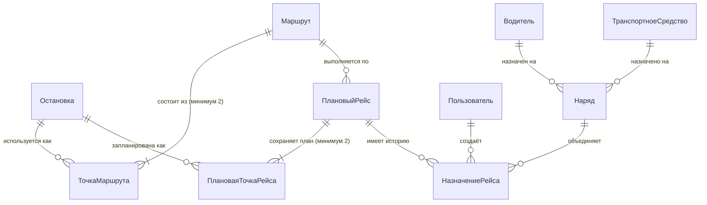
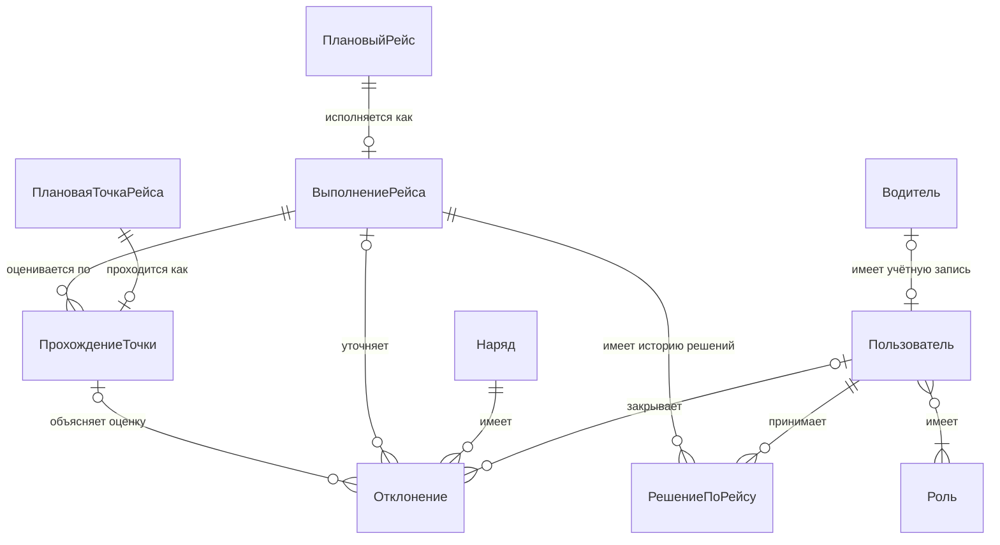
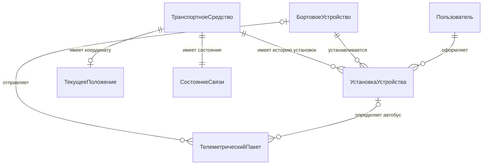

# 5. Концептуальная модель предметной области

## 5.1. ER-модель

### 5.1.1. Планирование и назначения

### 5.1.2. Выполнение, решения и отклонения

### 5.1.3. Устройства и телеметрия

Количество объектов в связи: 1 — ровно один, 0..1 — не более одного, 1..N — один или несколько,
0..N — любое количество; 2..N — не менее двух. В исходной Mermaid-схеме минимум две точки
дополнительно указан в подписи связи; в PDF и SVG он показан числом 2..N на конце связи.

## 5.2. Сущности

### Справочные данные

**Остановка** (Stop) — географическая точка посадки и высадки.
Атрибуты: _наименование_, _координата_ (широта, долгота), признак действующей.
Идентификатор: наименование в сочетании с координатой.

**Маршрут** (Route) — утверждённый путь следования.
Атрибуты: _номер маршрута_, _направление_, наименование, линия маршрута (геометрия), вид транспорта, признак действующего.
Идентификатор: номер маршрута и направление.

**ТочкаМаршрута** (RoutePoint) — остановка в составе маршрута.
Атрибуты: _порядковый номер в маршруте_, плановое смещение времени от начала рейса.
Идентификатор: маршрут в сочетании с порядковым номером. Слабая сущность: без маршрута не существует.

**ТранспортноеСредство** (Vehicle) — единица парка.
Атрибуты: _государственный регистрационный номер_, вид транспорта, вместимость, дата действия отметки о техническом состоянии, признак действующего.
Идентификатор: государственный регистрационный номер.

**БортовоеУстройство** — зарегистрированный источник телеметрии.
Атрибуты: постоянный идентификатор устройства, поставщик, формат сообщения, признак действующего.
Идентификатор не переиспользуется после списания. Устройство может временно не быть установлено.
Симулятор соблюдает тот же контракт идентификации сообщений, что и бортовое устройство (БП-18).

**УстановкаУстройства** — период закрепления одного устройства за одним автобусом.
Атрибуты: номер установки, начало, окончание (может отсутствовать), автор и основание установки,
автор и основание снятия. Каждая установка связана с одним устройством, одним автобусом и
пользователем, оформившим её. Идентификатор: номер установки. Период включает начало и не
включает окончание. У устройства и автобуса периоды установок не пересекаются (БП-19).
Закрытая установка сохраняется. Принадлежность принятого сообщения определяется по времени
его формирования и сохраняется; перемещение устройства её не переписывает. История нужна
для поздних сообщений и разбора событий прошлой смены, а не только для текущей карты.

**Водитель** (Driver) — работник, выполняющий рейсы.
Атрибуты: фамилия, имя, отчество, _номер водительского удостоверения_, дата действия допуска к выпуску, признак действующего.
Идентификатор: номер водительского удостоверения.

**Пользователь** (User) — учётная запись работника перевозчика.
Атрибуты: _логин_, фамилия и имя, признак активной.
Идентификатор: логин.

**Роль** (Role) — набор полномочий.
Атрибуты: _наименование роли_ (перечисление: администратор справочных данных, диспетчер, водитель,
аналитик).
Идентификатор: наименование роли. У пользователя одна или несколько ролей; роль может быть ещё никому не назначена.

### Планирование и выполнение

**ПлановыйРейс** (PlannedTrip) — предусмотренный расписанием проход маршрута.
Атрибуты: _дата_, _плановое время начала_, плановая длительность, сохранённая линия маршрута для контроля схода, время создания копии плана, время и автор последнего явного обновления, основание обновления, время окончательной фиксации (до первого выпуска отсутствует).
Порядок остановок и времена представлены сущностью «ПлановаяТочкаРейса».
Идентификатор: маршрут в сочетании с датой, плановым временем начала (направление определено маршрутом).

**ПлановаяТочкаРейса** — запланированное посещение остановки в конкретном рейсе.
Атрибуты: порядковый номер, плановое время прибытия, сохранённые наименование и координата остановки.
Идентификатор: плановый рейс и порядковый номер. Создаётся по точке маршрута при формировании плана.
При формировании задания создаётся рабочая копия плана. Справочник не обновляет её автоматически.
До первого выпуска администратор может явно обновить точки, времена и линию по БП-16; дата,
маршрут и плановое начало рейса остаются прежними. При первом выпуске копия окончательно
фиксируется вместе с созданием выполнения. После этого набор точек, их порядок, координаты,
времена и линия не изменяются, в том числе при подмене. Справочник меняется независимо.
Связь с остановкой указывает происхождение; для оценки используются сохранённые координаты.

**Наряд** (Duty) — назначение пары «водитель — транспортное средство» на набор плановых рейсов
одной смены.
Атрибуты: _номер наряда_, дата смены, статус (перечисление: запланирован, на линии, закрыт, отменён), время
выпуска, время закрытия, автор и причина закрытия, отметка непроверенных результатов, суммарная плановая длительность.
Идентификатор: номер наряда, присваиваемый при планировании. Состав наряда определяется записями назначения рейсов; исторические назначения не удаляются.

**НазначениеРейса** — факт включения одного планового рейса в один наряд.
Атрибуты: номер записи назначения, начало действия, окончание действия (может отсутствовать),
причина назначения, автор создания; при прекращении — автор и причина прекращения.
Идентификатор: номер записи назначения. У одного рейса не более одной записи без окончания действия.
При подмене прежняя запись заканчивается, новая начинается в тот же момент; у них разные наряды.
Завершённые рейсы сохраняют последнее назначение на закрытый наряд. Наличие текущей записи
назначения само по себе не означает, что наряд на линии или водитель занят.

**ВыполнениеРейса** (TripExecution) — состояние и результат исполнения планового рейса.
Атрибуты: статус (перечисление: ожидает, выполняется, завершён, требует проверки, не выполнен), фактическое время
начала, фактическое время окончания. Доля точек в графике вычисляется по БП-15 и не является самостоятельным фактом выполнения.
Идентификатор: плановый рейс. Связь с плановым рейсом «один к нулю или одному»: выполнение создаётся при первом выпуске рейса в статусе «ожидает»; при переносе ожидающего рейса эта же запись сохраняется; неизвестный результат отличается от подтверждённого невыполнения. Текущие подтверждённые времена, источник завершения, время прекращения при прерывании, следующая ожидаемая точка и следующий срок проверки хранятся в выполнении. Каждое ручное решение и попытка проверки представлены отдельной сущностью «РешениеПоРейсу». Текущий статус меняется как по ручным решениям, так и по телеметрии и истечению срока; он не определяется только последним ручным решением. Ручное завершение не создаёт прохождения.

**РешениеПоРейсу** — сохранённый результат одной проверки или подтверждения диспетчером.
Атрибуты: порядковый номер в истории выполнения, время регистрации решения, исход
(продолжить движение, подтвердить завершение, подтвердить невыполнение, сведений недостаточно),
основание, статус до и после решения. В зависимости от исхода сохраняются подтверждённые
начало и окончание либо время прекращения, следующая ожидаемая плановая точка и назначенный срок проверки.
Идентификатор: выполнение рейса и порядковый номер решения. Каждая запись относится ровно
к одному выполнению и имеет ровно одного автора-пользователя. У выполнения может быть любое
число решений, в том числе ни одного. Записи не изменяются и не удаляются; последующая
допустимая проверка добавляет запись, сохраняя прежние основания, времена и сроки.
При исходе «сведений недостаточно» статусы до и после одинаковы, новый срок не назначается;
основание описывает, какие сведения проверены и чего не хватило. Следующая точка, если указана,
принадлежит тому же плановому рейсу. Состав обязательных данных и допустимость решения определяет БП-13.
Сохранение принятого решения и его изменений выполнения производится вместе. Отклонённый
некорректный запрос не становится принятым решением. Автоматическое истечение срока меняет
выполнение, но не создаёт ручного решения с вымышленным автором.

**ПрохождениеТочки** (CheckpointPassage) — зафиксированный факт прибытия в контрольную точку.
Атрибуты: фактическое время прибытия, отклонение от планового времени (в минутах), признак «в
графике», признак достоверности, причина и автор исправления.
Идентификатор: плановая точка рейса. Прохождение связано с выполнением того же планового рейса;
его время сравнивается с сохранённым временем плановой точки, а не с текущим справочником.

**Отклонение** (Deviation) — расхождение фактического исполнения с планом.
Атрибуты: номер отклонения, тип (перечисление: опоздание, опережение, сход с маршрута, потеря связи, невыполнение
рейса), время обнаружения, числовое значение отклонения, статус (открыто, закрыто), причина закрытия
(перечисление, включая «выполнена подмена» и «недостоверные данные»), комментарий, время закрытия.
Идентификатор: номер отклонения. Время и тип сами по себе не гарантируют уникальности.
Для опоздания и опережения обязательна связь с конкретным прохождением и его выполнением; прохождение и выполнение должны относиться к одному плановому рейсу.
Для невыполнения и схода обязательно выполнение, а прохождение не требуется. Потеря связи
может относиться только к наряду, в том числе между рейсами. Наряд — тот, к которому событие
относилось при обнаружении; последующие подмены эту связь не переписывают.

### Данные о движении

**ТелеметрическийПакет** (TelemetryPacket) — единичное сообщение бортового устройства.
Атрибуты: регистрационный номер получения, время получения, идентификатор бортового устройства, идентификатор исходного сообщения, время формирования, координата, скорость, состав
дополнительных полей зависит от поставщика оборудования и заранее не фиксирован, состояние разбора
(разобран, не разобран, неизвестное устройство), пригодность для расчётов и причина отказа.
При указанной установке её устройство совпадает с источником пакета.
Идентификатор записи получения: регистрационный номер при приёме. Одна исходная посылка
может иметь несколько получений. Её ключ — идентификатор устройства и постоянный идентификатор
сообщения, присвоенный до первой отправки. Сохраняются результат дедупликации (первое получение,
повтор, конфликт идентификатора, ключ не определён), ссылка на первое получение при наличии,
отпечаток содержимого, время первого получения и определённая установка. Правила сравнения и
срок хранения ключей заданы в БП-18. Номер получения не используется как ключ дедупликации.
Неизвестное устройство, отсутствие установки или обязательного ключа исключают автоматические
изменения состояния автобуса и рейса. Исходное содержимое такого получения остаётся для разбора.
Замечание: переменный состав атрибутов — характеристика предметной области, а не решение о
хранилище.

**ТекущееПоложение** (CurrentPosition) — последнее известное состояние транспортного средства.
Атрибуты: координата, скорость при наличии, время формирования координаты, признак актуальности по БП-08.
Идентификатор: транспортное средство. Производная сущность: восстанавливается из сохранённой
последней принятой координаты с установкой, временем и ключом источника либо из доступных пригодных пакетов; до первой пригодной координаты отсутствует, затем существует не более одного экземпляра на транспортное средство.

**СостояниеСвязи** — производные сведения о подтверждениях связи бортового устройства автобуса по БП-08.
Атрибуты: время последнего подтверждения связи по БП-08 (может отсутствовать), состояние
(сообщений ещё не было, на связи, потеря связи), начало текущего периода потери связи. Для нового выпуска отсчёт идёт не раньше его времени: учитываются только подтверждения по БП-08 после этого выпуска.
Идентификатор: транспортное средство. Создаётся при регистрации автобуса, независимо от наличия
пригодных координат. Для автобуса на линии при отсутствии сообщений отсчёт идёт от времени выпуска
текущего наряда. Сообщение с непригодной координатой может восстановить связь по БП-08,
не создавая и не обновляя текущее положение. Вне линии отклонение потери связи не создаётся.

## 5.3. Связи и их кардинальность

| Связь | Кратность | Пояснение |
|---|---|---|
| Маршрут — ТочкаМаршрута | 1 : 2..N | Маршрут содержит не менее двух точек (БП-16). |
| Остановка — ТочкаМаршрута | 1 : 0..N | Одна остановка используется несколькими маршрутами. |
| Маршрут — ПлановыйРейс | 1 : 0..N | Расписание маршрута на дату. |
| ПлановыйРейс — ПлановаяТочкаРейса | 1 : 2..N | Сохранённый план остановок конкретного рейса. |
| Остановка — ПлановаяТочкаРейса | 1 : 0..N | Источник; последующее изменение остановки не переписывает план. |
| Наряд — НазначениеРейса | 1 : 0..N | Каждое назначение относится к одному наряду. При выпуске нужно хотя бы одно текущее назначение. |
| ПлановыйРейс — НазначениеРейса | 1 : 0..N | История; не более одной текущей записи на рейс. |
| Пользователь — НазначениеРейса | 1 : 0..N | Автор создания; автор прекращения также сохраняется при наличии. |
| Водитель — Наряд | 1 : 0..N | В статусе «на линии» — не более одного наряда (БП-03). |
| ТранспортноеСредство — Наряд | 1 : 0..N | В статусе «на линии» — не более одного наряда (БП-02). |
| ПлановыйРейс — ВыполнениеРейса | 1 : 0..1 | Выполнение создаётся при выпуске наряда. |
| ВыполнениеРейса — РешениеПоРейсу | 1 : 0..N | Каждое решение или попытка проверки — отдельная неизменяемая запись. |
| Пользователь — РешениеПоРейсу | 1 : 0..N | У каждой записи ровно один автор-диспетчер. |
| ВыполнениеРейса — ПрохождениеТочки | 1 : 0..N | По одному на пройденную контрольную точку. |
| ПлановаяТочкаРейса — ПрохождениеТочки | 1 : 0..1 | Один зафиксированный факт на плановую точку. |
| ПрохождениеТочки — Отклонение | 0..1 : 0..N | Для опоздания и опережения прохождение обязательно, для остальных типов отсутствует. |
| ВыполнениеРейса — Отклонение | 0..1 : 0..N | Для опоздания, опережения, схода и невыполнения обязательна; для потери связи между рейсами отсутствует. |
| Наряд — Отклонение | 1 : 0..N | В том числе потеря связи между рейсами. |
| Пользователь — Отклонение | 0..1 : 0..N | Кто закрыл отклонение; у открытых отклонений связи нет. |
| Пользователь — Роль | 0..N : 1..N | У пользователя минимум одна роль; у роли может не быть пользователей. |
| Водитель — Пользователь | 0..1 : 0..1 | Водителю учётная запись нужна только для просмотра наряда. |
| ТранспортноеСредство — УстановкаУстройства | 1 : 0..N | История; одновременно не более одной установки. |
| БортовоеУстройство — УстановкаУстройства | 1 : 0..N | История; одновременно не более одного автобуса. |
| Пользователь — УстановкаУстройства | 1 : 0..N | Автор установки; автор снятия сохраняется отдельно. |
| БортовоеУстройство — ТелеметрическийПакет | 0..1 : 0..N | Для неизвестного идентификатора зарегистрированное устройство не определено. |
| УстановкаУстройства — ТелеметрическийПакет | 0..1 : 0..N | Установка на момент формирования; без пригодного времени или подходящей установки связи нет. |
| ТранспортноеСредство — ТекущееПоложение | 1 : 0..1 | Появляется с первой пригодной координатой. |
| ТранспортноеСредство — СостояниеСвязи | 1 : 1 | Существует и до первой координаты. |

## 5.4. Решения, принятые на этом уровне

- **Плановый рейс и выполнение рейса разделены.** План существует до и независимо от факта, иначе
  невозможно зафиксировать невыполненный рейс (БП-13) — он может не иметь фактических данных либо быть прерван после начала, но должен
  учитываться в отчёте.
- **Отклонение — одна сущность с типом**, отдельной сущности «инцидент» нет (ЖР-05).
- **Текущее положение выделено в отдельную сущность**, хотя выводится из телеметрии. Причина: у него
  другой жизненный цикл — координата обновляется, тогда как пакеты только добавляются. Состояние связи
  существует отдельно, в том числе до первой координаты.
- **Наряд отделён от планового рейса.** Наряд отвечает на вопрос «кто и на чём», плановый рейс — «что
  и когда». Подмена транспортного средства (БС-05, альтернатива А1) меняет наряд, не затрагивая план.
- **Мультиарендность не вводится**: перевозчик один, ключ арендатора добавил бы атрибут во все
  сущности и ни одного сценария.

- **Плановая точка рейса сохраняет план.** Прохождение сравнивается с условиями конкретного
  рейса; редактирование справочника не меняет прошлую оценку (БП-16).
- **Назначение рейса сохраняет историю.** Можно установить, кто и когда перенёс рейс в другой
  наряд, без удаления прежней связи (БП-01, БП-17).
- **Отклонение связано с оцениваемым прохождением.** Признание опоздания недостоверным изменяет
  достоверность именно нужного прохождения, поэтому отчёт пересчитывается однозначно (БП-15).

Справочные объекты,
на которые ссылается история, выводятся из использования, а не удаляются вместе с историей.

## 5.5. Производные данные и их источники

| Данные | На чём основаны | Как сохраняется согласованность |
|---|---|---|
| Текущее положение | Последняя принятая по БП-07 координата, её время, установка и ключ сообщения | Обновление только вперёд по времени. Долговечный контрольный снимок сохраняется вместе с обработкой; потеря быстрого кэша не стирает старую координату. |
| Состояние связи | Последнее подтверждение по БП-08, выпуск наряда, текущее время и действующая установка | Пересчитывается по времени. Отсутствие ключа в кэше не считается доказательством потери связи. |
| Прогноз прибытия | Сохранённый план, текущее выполнение, достоверное прохождение и актуальность координаты | Вычисляется по БП-14; после исправления прохождения или статуса прежний прогноз недействителен. |
| K, N и доля точек в графике | Достоверные прохождения завершённых рейсов по БП-15 | Пересчитываются из фактов. При N = 0 — «нет данных»; доля не хранится как независимый атрибут выполнения. |
| Разница времени и «в графике» у прохождения | Фактическое время и неизменный план | Производные атрибуты; при допустимом исправлении исходных данных пересчитываются вместе с ними. |
| Счётчики статусов в отчёте | Плановые рейсы и текущее состояние их выполнения | Категории непересекающиеся; ручное решение меняет факты, после чего отчёт пересчитывается. |

Прохождение, подтверждённый результат рейса, отклонение и решение диспетчера — сохраняемые
бизнес-факты. Они не исчезают при потере производных данных. Даже после удаления сырой
телеметрии сохраняются фактические времена, план, основания решений и использованные для
подтверждения выдержки из сообщений. Ссылка на удалённый сырой пакет не заменяет основание.
При снятии устройства последнее положение автобуса сохраняется с пометкой об отсутствии
действующего источника и не используется для прогноза; новый источник обновляет его только
после пригодного сообщения. Контроль связи начинается заново при следующем выпуске.
