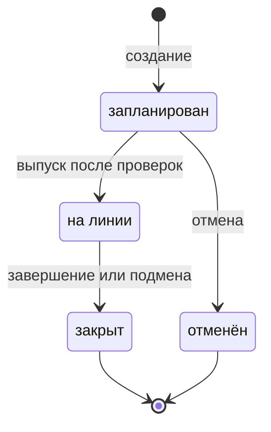
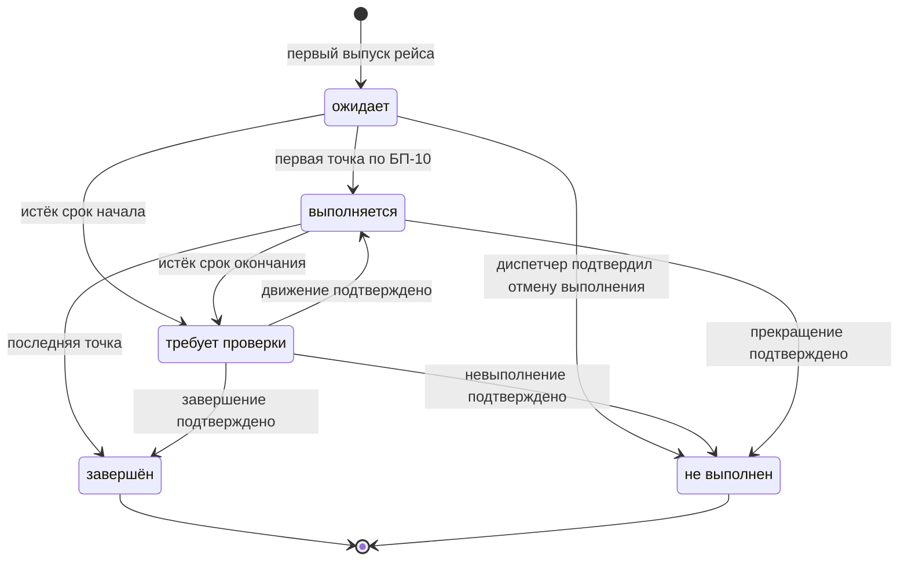
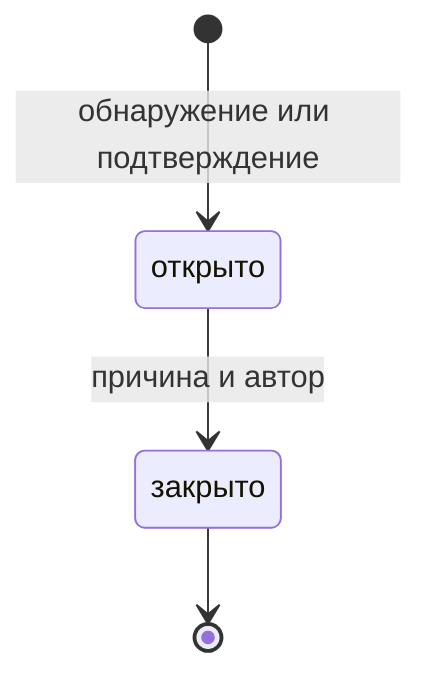

# 7. Жизненные циклы трёх основных сущностей

## 7.1. Наряд

- **Создание → запланирован.** Администратор в БС-01 сохраняет непротиворечивые назначения.
- **Запланирован → на линии.** Диспетчер в БС-02 проверяет БП-02–БП-06, фиксирует выпуск.
  У впервые выпущенных рейсов появляются выполнения «ожидает».
- **Запланирован → отменён.** Диспетчер в БС-05 прекращает назначения; плановые рейсы остаются
  для назначения в другой наряд. Выполнения не создаются. Повторный выпуск отменённого запрещён.
- **На линии → закрыт, обычный путь.** Все выполнения завершены или подтверждённо не выполнены.
  Диспетчер фиксирует закрытие, автобус и водитель больше не заняты этим нарядом.
- **На линии → закрыт, есть неизвестные результаты.** Нет ожидающих или выполняющихся рейсов,
  но есть «требует проверки». Диспетчер сохраняет причину и явную отметку; неизвестные результаты
  не превращаются в завершённые или невыполненные. Их проверка возможна после закрытия.
- **На линии → закрыт, подмена.** Между рейсами выполняется БП-17: ожидающие переносятся в новый
  наряд, новый сразу выпускается, старый закрывается. Все проверки относятся к итоговому состоянию.
  При отказе старый остаётся на линии и ни одно назначение не переносится.

**Инварианты:** закрытый наряд не открывается повторно; его история сохраняется. Пока наряд
на линии, автобус и водитель не могут быть на линии в другом наряде. Завершение последнего
рейса само по себе не закрывает наряд: требуется действие диспетчера.

**Пример:** Д-1 выпущен в 09:50; первый рейс завершён в 10:20; в 10:25 автобус заменён.
Д-1 закрывается, Д-2 на другом автобусе выпускается с оставшимися рейсами. Тот же водитель
может продолжить работу: одновременно двух нарядов на линии у него нет. См. КП-05.2.

## 7.2. Выполнение рейса

- **Создание → ожидает.** БС-02, первый выпуск планового рейса.
- **Ожидает → выполняется.** БС-04, первая точка в допустимое время по БП-10.
- **Выполняется → завершён.** Зафиксирована последняя точка после последовательного контроля. После ручного возврата контроль идёт с указанной диспетчером следующей точки; прежние пропуски остаются пропусками.
- **Ожидает/выполняется → требует проверки.** Истёк соответствующий срок БП-13 без подтверждения.
- **Требует проверки → выполняется.** Диспетчер подтвердил начало и продолжение движения;
  наряд на линии, конкурирующего выполнения нет. Указывает следующую точку, новый срок проверки
  рассчитывается по БП-13. Пропущенные прохождения не создаются.
- **Требует проверки → завершён.** Диспетчер подтвердил полное выполнение, сохранил основание,
  фактическое начало и окончание. Решение допустимо после закрытия наряда и не создаёт прохождения.
- **Требует проверки / выполняется → не выполнен.** Подтверждено, что полный рейс не выполнен.
  При состоявшемся начале сохраняется время прекращения; такой рейс отмечается как прерванный.
- **Ожидает → не выполнен.** Диспетчер подтвердил отмену до начала. Фактических времён нет.
- **Требует проверки → требует проверки.** Доказательств недостаточно. Статус не меняется,
  добавляется отдельная запись «РешениеПоРейсу»; переход в другое состояние не происходит.

**Инварианты:** у выпущенного планового рейса одна запись выполнения и любое число записей
«РешениеПоРейсу». Каждая проверка добавляет запись, включая недостаток сведений. Автоматическое
истечение срока не создаёт ручного решения. Повторные циклы сохраняют прежние решения и сроки
(КП-05.13, КП-05.14). Ручное решение сохраняет автора,
время и основание. Время начала не позже окончания, окончание не в будущем. Решение не создаёт
вымышленных прохождений. Поздний пакет сам по себе не меняет проверяемый или итоговый статус.
Закрытый наряд не открывается при проверке результата; возврат такого рейса в работу запрещён.

**Пример:** план 10:00–10:30. В 10:50 диспетчер возвращает рейс в работу со сроком 11:05.
После его истечения можно провести новую проверку. Каждая попытка сохраняется отдельно,
даже если сведений снова недостаточно (КП-05.14).

## 7.3. Отклонение

- **Создание → открыто.** Система обнаружила опоздание, опережение, сход или потерю связи;
  для невыполнения сначала требуется подтверждение диспетчера.
- **Открыто → закрыто.** Диспетчер в БС-05 указал причину; сохраняются автор и время.
- **Открыто → открыто.** Повторная проверка той же ситуации не создаёт дубликат; конец смены
  сам по себе не закрывает запись. Восстановление связи тоже не заменяет её разбор диспетчером.

**Инварианты:** закрытие не стирает факт нарушения. Только признание опоздания/опережения
недостоверным меняет пригодность связанного прохождения для отчёта по БП-15. Закрытое отклонение
не открывается повторно в базовой версии. Новый период потери связи создаёт отдельную запись,
даже если прежнее отклонение ещё открыто. История не удаляется.

**Пример:** потеря связи зарегистрирована в 10:03:01, сообщения восстановились в 10:04,
диспетчер разобрал ситуацию в 10:05. Состояние связи восстановлено в 10:04, отклонение закрыто
в 10:05. Это разные события и разные сущности. См. КП-03.3, КП-03.4, КП-05.1.
