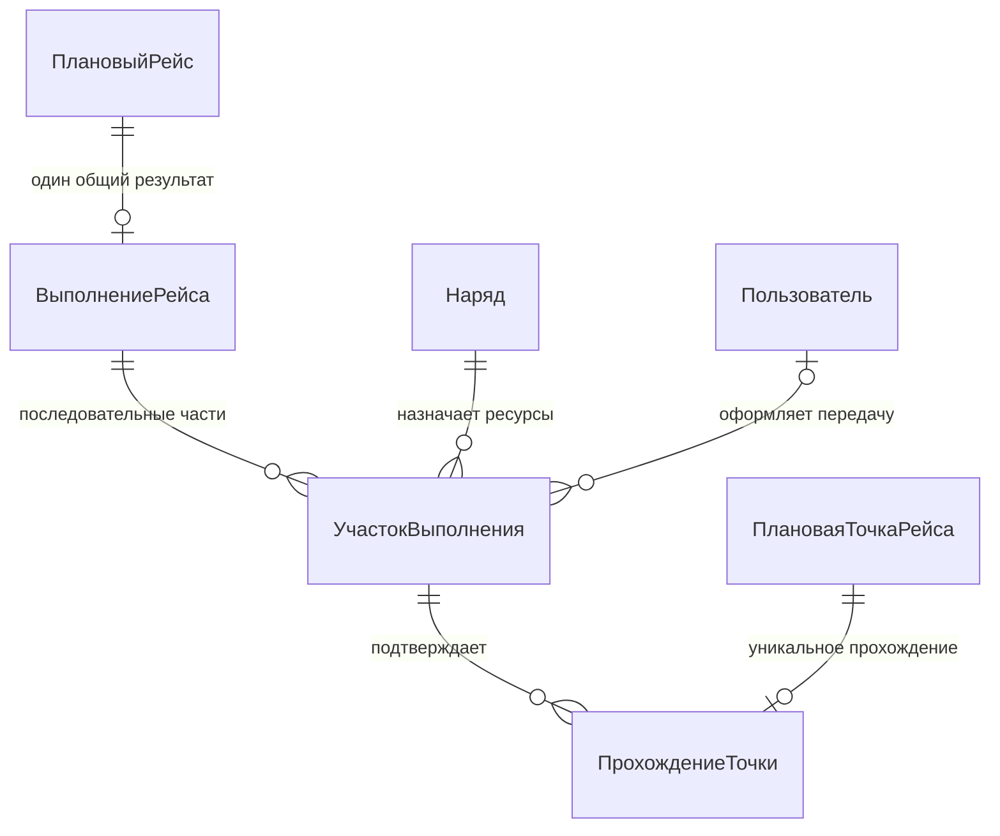

# 8. Изменение ключевого требования и карта влияния

## 8.1. Исходное требование и изменение

**База, БП-01 и БП-17:** начатый рейс не переносится между автобусами. Подмена возможна только
между рейсами; выполнение одного планового рейса не делится на участки.

**ИЗМ-01:** разрешить диспетчеру заменить автобус и при необходимости водителя во время
выполняющегося рейса на уже достигнутой остановке, сохранив один плановый рейс, один общий
результат и сведения о том, кто выполнил каждую часть.

**Причина изменения:** после поломки пассажиры пересаживаются в резервный автобус,
который продолжает тот же рейс. Полный срыв и начало нового рейса исказили бы статистику.

Рассмотрим, как такое изменение повлияет на принятые требования.

## 8.2. Конкретный пример «до → после»

Рейс Р-1 имеет точки А 10:00, Б 10:10, В 10:20, Г 10:30. Автобус Т-1, водитель В-1,
наряд Д-1. В базе и в эксперименте точность расписания одинакова: от −2 до +5 минут.

1. Т-1 проходит А в 10:00 и Б в 10:12, после чего ломается.
2. В 10:16 на Б доступен резервный Т-2 с водителем В-2 и действующими допусками.
3. По действующим правилам диспетчер не может передать начатый рейс: запрос подмены отклоняется по БП-17.
   Если продолжить рейс невозможно и это подтверждено, Р-1 получает «не выполнен»;
   известные прохождения А и Б сохраняются, но не входят в долю завершённых рейсов.
4. После изменения диспетчер передаёт оставшуюся часть Р-1 резерву. Участок У-1 заканчивается в 10:16,
   У-2 начинается в 10:16; время самой пересадки не записывается как второе прохождение Б.
5. Т-2 проходит В в 10:24 и Г в 10:33. Р-1 завершён один раз, 4 прохождения в графике:
   отклонения от плана 0, +2, +4 и +3 минуты. N = 4, K = 4, показатель 100,0%.
   История показывает два автобуса и двух водителей; количество рейсов равно одному.

Следствие: простой перенос ссылки «автобус» потерял бы сведения о Т-1. Создание второго
планового рейса удвоило бы объём плана. Для ИЗМ-01 требуется история частей выполнения.

## 8.3. Правила экспериментальной версии

- **ИЗМ-БП-01.** У одного выполнения может быть несколько последовательных участков,
  но не более одного незакрытого участка в каждый момент. Периоды [начало; конец) не пересекаются.
- **ИЗМ-БП-02.** Передача разрешена, когда оба автобуса имеют свежие пригодные координаты
  в радиусе 50 метров от последней достоверно пройденной плановой точки. Нужна непройденная
  следующая точка. Нельзя передавать рейс «требует проверки», завершённый или не выполненный.
- **ИЗМ-БП-03.** При подмене повторно проверяются допуски и итоговая занятость ресурсов.
  Завершение старого участка, создание нового, закрытие старого наряда, выпуск нового и перенос
  оставшихся назначений применяются вместе. Любой отказ сохраняет прежнее состояние полностью.
- **ИЗМ-БП-04.** Каждое прохождение связано с одним участком. После передачи контроль продолжается
  со следующей точки; уже пройденные точки не дублируются. Ожидающие рейсы старого наряда переносятся
  по прежнему правилу. Запись общего выполнения начатого рейса сохраняется.
- **ИЗМ-БП-05.** После передачи пакеты прежнего автобуса остаются в его истории и могут обновлять
  его собственное положение, но больше не оценивают переданный рейс. Поздние пакеты не пересматривают
  закрытый участок. Автор передачи и причина сохраняются.
- **ИЗМ-БП-06.** Во время ожидания резерва прогноз для передаваемого рейса недоступен. После передачи
  прогноз до первой новой пройденной точки также недоступен; при возможности показывается будущее
  плановое время. Начиная с первого прохождения нового участка применяется прежняя формула БП-14.
- **ИЗМ-БП-07.** В общем отчёте считаются плановые рейсы и уникальные прохождения, а не участки.
  Фильтрация или детализация по автобусу использует участки и не меняет число плановых рейсов.

## 8.4. Карта влияния на сценарии и правила

| Объект | Что меняется | Почему |
|---|---|---|
| БС-01, БП-04 | Начальный план не меняется; модель назначения допускает последующие переносы начатого рейса. | Состав и время плановых рейсов не зависят от поломки. |
| БС-02, БП-02–БП-06 | Первый выпуск создаёт первый участок при начале рейса; резерв выпускается в составе передачи. | Проверка допуска и занятости нужна и для резерва. |
| БС-03, БП-07–БП-09 | Приём пакетов прежний; источник для оценки рейса выбирается по действующему участку. | Поток Т-1 нельзя принять за движение Т-2. |
| БС-04, БП-10–БП-13 | Начало общего выполнения однократно; передача не сбрасывает следующую точку и не создаёт невыполнение. | Один план исполняют последовательно два автобуса. |
| БС-05, БП-01, БП-17 | Добавляется передача на остановке по ИЗМ-БП-01–ИЗМ-БП-05. | Основное изменённое действие диспетчера. |
| БС-06, БП-14 | Временное отсутствие прогноза и смена источника координат по ИЗМ-БП-06. | До первого прохождения резервом прежнее опоздание недостаточно характеризует продолжение. |
| БС-07, БП-15 | Формула K/N прежняя; прохождения объединяются по общему выполнению без дублей. | Два участка не должны давать два рейса. |
| БП-16, справочники | Порядок, координаты и времена плановых точек не меняются. | Это сохранённый план, с которым сравниваются оба участка. |

Карта прослеживается до данных: ИЗМ-01 → БС-05 → ИЗМ-БП-03 → УчастокВыполнения,
НазначениеРейса, Наряд → ИЗМ-КП-01. Вторичная цепочка: ИЗМ-01 → БС-07 → БП-15 →
ПрохождениеТочки → ИЗМ-КП-04. Таким образом изменение затрагивает и операцию, и итоговую оценку.

## 8.5. Изменение концептуальной модели

По действующим правилам нет сущности участка; ПрохождениеТочки связано с общим выполнением и плановой точкой.
После изменения добавляется **УчастокВыполнения** — часть одного выполнения, порученная одному наряду.
Атрибуты: порядковый номер внутри выполнения, начало и конец, причина передачи,
последняя пройденная точка при передаче. Автор создания — пользователь-диспетчер для передачи;
первый участок создаётся системой по началу рейса.

Это фрагмент изменённой модели, а не замена полной базовой диаграммы. Остальные 20 сущностей сохраняются;
полная модель после изменения имеет 21 сущность. История «РешениеПоРейсу» сохраняется у общего выполнения. Прямая связь ВыполнениеРейса — ПрохождениеТочки становится
производной через участок. Ожидающее выполнение ещё не имеет участков; начатое имеет минимум один.

- **НазначениеРейса:** разрешена смена текущего наряда у выполняющегося рейса через передачу;
  история назначений сохраняется, исходные ограничения для обычного редактирования остаются.
- **ПрохождениеТочки:** добавляется обязательный участок; плановая точка принадлежит тому же
  рейсу, что и общее выполнение участка. Уникальность прохождения плановой точки сохраняется.
- **Отклонение:** прежняя связь с нарядом фиксирует ресурсы в момент события; опоздание по-прежнему
  связано с прохождением, через него можно получить участок. Потеря связи остаётся событием наряда.
- **ВыполнениеРейса:** во время передачи остаётся «выполняется»; новый статус общего выполнения
  не требуется. Начатое выполнение имеет один активный участок до завершения или проверки результата.
- **Наряд:** получает дополнительное основание закрытия — передача начатого рейса.

В журнале событий передачи сохраняются обе стороны и автор. Сведения об автобусе на У-1
получаются через Д-1, об автобусе на У-2 через Д-2. Ни одна историческая связь не переписывается.

## 8.6. Примеры приёмки после изменения

Ожидаемые результаты для примера с рейсом Р-1:

- **ИЗМ-КП-01. Успешная передача.** Дано пример 8.2. В 10:16 оба автобуса на Б, допуски действуют,
  Т-2 и В-2 свободны. После передачи У-1 закрыт, У-2 открыт, Д-1 закрыт, Д-2 на линии,
  текущий наряд Р-1 — Д-2, общее выполнение по-прежнему одно. Следующая точка — В.
- **ИЗМ-КП-02. Отказ.** У Т-2 допуск истёк. Подмена отклоняется; Д-1 и У-1 остаются активными,
  Д-2 и У-2 не создаются, назначения не меняются. Результат следует из ИЗМ-БП-03.
- **ИЗМ-КП-03. Поздний пакет.** После передачи пришёл пакет Т-1 с временем 10:15:50 на Б.
  История пакетов сохраняет его; второго прохождения Б и нового участка не появляется.
- **ИЗМ-КП-04. Отчёт.** После Г в 10:33 Р-1 завершён один раз. K = 4, N = 4,
  100 × 4 / 4 = 100,0%; в детализации два участка. Это не два завершённых рейса.
- **ИЗМ-КП-05. Прогноз.** В 10:16 сразу после передачи прогноз скрыт, для В доступно плановое
  10:20. После прохождения В в 10:24 прогноз Г = 10:30 + 4 минуты = 10:34.
- **ИЗМ-КП-06. Одновременная передача.** Два диспетчера передают Р-1 разным резервам.
  Разрешена только одна операция: у Р-1 один текущий наряд и один незакрытый участок;
  второй запрос получает отказ, так как исходный участок уже закрыт.
- **ИЗМ-КП-07. Не на остановке.** У Т-1 нет свежей координаты у последней пройденной точки.
  Подмена отклоняется по ИЗМ-БП-02; недостаточность данных не подменяется догадкой о месте пересадки.

## 8.7. Вывод по эксперименту

ИЗМ-01 требует не только убрать запрет БП-17: нужны участки выполнения, правила передачи,
смена источника телеметрии и сохранение единого результата отчёта. Изменение затрагивает все семь
сценариев напрямую или через используемые данные, но не требует менять план маршрута и формулу K/N.

В текущем проекте подмена остаётся доступна только между рейсами. Передачу начатого рейса
можно добавить позже по описанным правилам.
